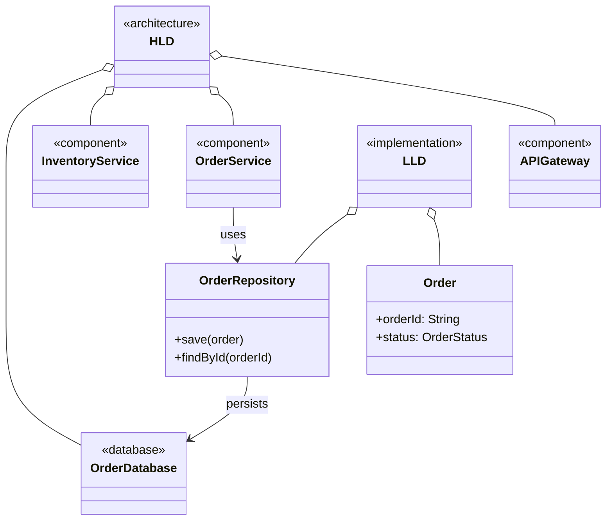

## LLD vs HLD

### Low-level design (LLD)

LLD focuses on a feature or module.

Questions it answers:

- What classes are needed?
- What interfaces and methods exist?
- How do entities and services interact?
- What edge cases and validations are required?

Examples:

- Parking Lot
- Library Management System
- Ride Sharing System
- Splitwise clone

### High-level design (HLD)

HLD focuses on the overall system.

Questions it answers:

- What are the main components?
- What database and cache choices are needed?
- How do services communicate?
- How do we handle scale, load, and failure?

Examples:

- URL shortener
- Notification service
- Chat system
- E-commerce platform

## Core system-design concepts

### Functional requirements (FR)

Functional requirements describe what the system must do.

Examples:

- create an order
- send a message
- fetch user profile
- process payment

### Non-functional requirements (NFR)

Non-functional requirements describe quality attributes of the system.

Examples:

- availability
- latency
- scalability
- reliability
- security
- consistency
- fault tolerance

### CAP theorem

CAP says that in a distributed system, you can usually guarantee only two of the following three at the same time:

- Consistency
- Availability
- Partition tolerance

Typical tradeoff examples:

- strong consistency usually reduces availability under partitions
- eventual consistency improves availability and partition tolerance
- choosing the right tradeoff depends on business needs

### Load balancer

A load balancer distributes requests across multiple servers to improve:

- availability
- throughput
- fault tolerance
- scalability

Common patterns:

- round-robin
- least-connections
- IP hash
- weighted balancing

### UML: connect HLD and LLD

HLD answers “which major parts exist and how do they connect?” LLD answers “which classes and methods implement one part?” The diagram is illustrative: an order service could be a deployable service in HLD and a Java class/module in LLD.
