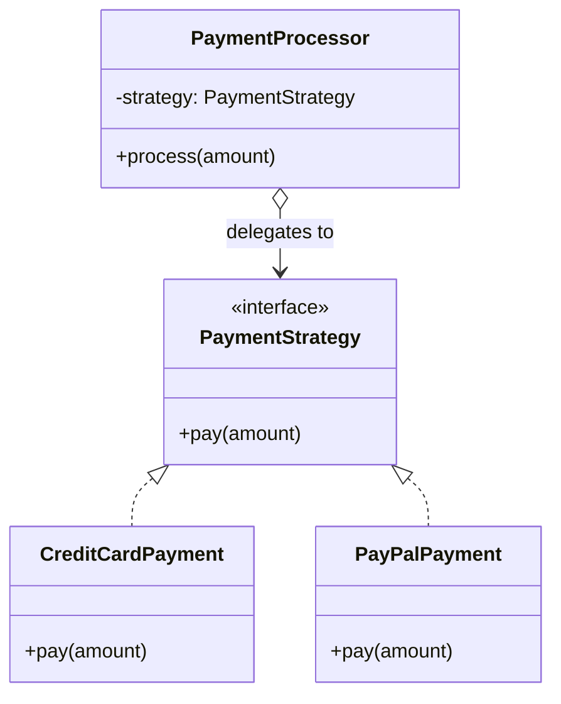

## Design pattern categories

### Creational

- Factory
- Abstract Factory
- Builder
- Singleton
- Prototype

### Structural

- Adapter
- Decorator
- Facade
- Proxy
- Composite
- Bridge

### Behavioral

- Strategy
- Observer
- Command
- State
- Template Method
- Chain of Responsibility

## UML: Strategy pattern

The interface is the stable contract. Concrete strategies provide different algorithms; the processor delegates instead of branching on payment type. See the [behavioral pattern example](../06_behavioral_patterns/DesignPatternsExample.java) for runnable Java and the [pattern guide](../06_behavioral_patterns/_README.md) for the dry run.

Pattern examples already in this repository:

- [Factory example](../04_creational_patterns/FactoryPatternExample.java): centralizes object creation.
- [Strategy example](../06_behavioral_patterns/DesignPatternsExample.java): swaps payment behavior behind an interface.
- [Adapter example](../05_structural_patterns/StructuralPatternsExample.java): translates a legacy API into an application interface.
