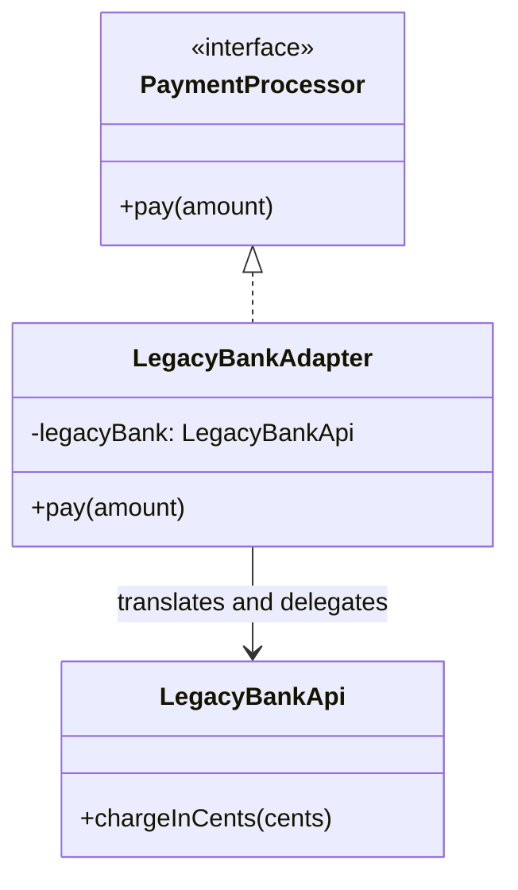

# Structural Patterns

Structural patterns explain how objects and classes can be composed to form larger structures while keeping the system flexible and maintainable.

## 1. Adapter Pattern

Use when:
- two incompatible interfaces need to work together

Example:
- a legacy `OldPaymentGateway` is adapted to a new `PaymentGateway` interface

Runnable Java example: [StructuralPatternsExample.java](StructuralPatternsExample.java).



In the demo, the application asks for `pay(12.50)`. The adapter converts the `BigDecimal` amount to 1250 cents and calls the legacy method. Compile and run with `javac StructuralPatternsExample.java` and `java StructuralPatternsExample`. This demonstrates the Adapter pattern; it is not a real payment integration.

Expected output:

```text
Legacy bank charged 1250 cents
```

## 2. Decorator Pattern

Use when:
- you need to add behavior dynamically
- subclassing would create too many variants

Example:
- add logging, validation, or metrics to a service without changing the core service

## 3. Facade Pattern

Use when:
- a complex subsystem should be exposed through a simple interface

Example:
- a `OrderServiceFacade` hides inventory, payment, and shipping coordination

## 4. Proxy Pattern

Use when:
- you want to control access or add lazy initialization

Examples:
- virtual proxy for heavy object creation
- security proxy for access restriction
- remote proxy for networked services

## 5. Composite Pattern

Use when:
- objects form part of a tree or hierarchy
- individual and composite objects should be treated the same

Example:
- file system nodes: file vs folder

## 6. Bridge Pattern

Use when:
- abstraction and implementation should vary independently

Example:
- different database drivers behind a common repository interface

## Interview perspective

Structural patterns solve the problem of integrating components without creating tight coupling.

## Key takeaway

Structural patterns help you organize code so implementation details remain hidden while the system remains extensible.
