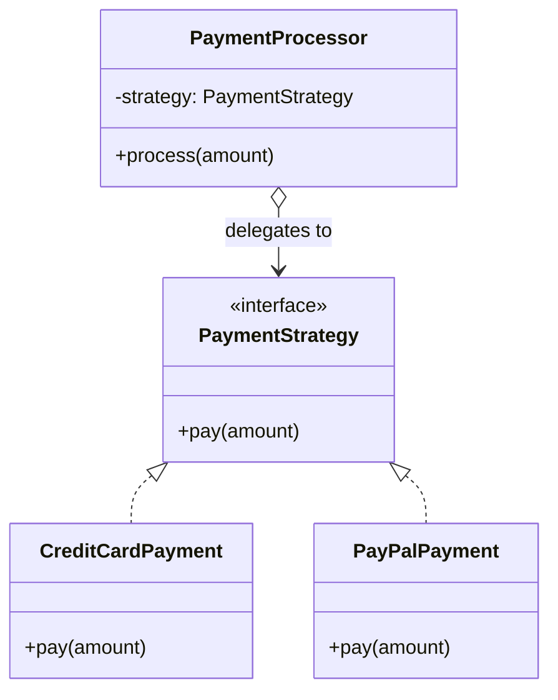

# Behavioral Patterns

Behavioral patterns focus on communication between objects and how responsibilities are distributed across the system.

## 1. Strategy Pattern

Runnable example: [DesignPatternsExample.java](DesignPatternsExample.java)

Dry run:

```text
Paid 500 using Credit Card
```

`PaymentProcessor` delegates to the injected `PaymentStrategy`, so another payment method can be selected without changing the processor.

UML class view:



Beginner walkthrough: `main` constructs a card strategy and passes it into `PaymentProcessor`. `process(500)` calls `strategy.pay(500)`, so the processor does not need to know card-specific steps. Replacing the injected object with `PayPalPayment` changes the behavior without changing `PaymentProcessor`.

Use when:
- multiple algorithms can be swapped at runtime

Example:
- payment strategies: card, wallet, UPI

## 2. Observer Pattern

Use when:
- multiple listeners need updates when state changes

Example:
- stock market price listeners
- email subscription notifications

## 3. Command Pattern

Use when:
- actions should be encapsulated as objects

Example:
- remote control or undo/redo system

## 4. Template Method Pattern

Use when:
- different steps are fixed but implementations vary at certain points

Example:
- algorithm skeleton with placeholder hooks for steps

## 5. State Pattern

Use when:
- an object behavior changes according to state

Example:
- order states: created, paid, shipped, delivered

## 6. Chain of Responsibility

Use when:
- multiple handlers process a request in sequence

Example:
- login validation chain: auth -> rate limit -> role check

## 7. Iterator Pattern

Use when:
- clients need to traverse a collection without exposing its internals

Example:
- Java `Iterator` interface

## Key takeaway

Behavioral patterns help design cleaner responsibility boundaries and clearer object interaction.
