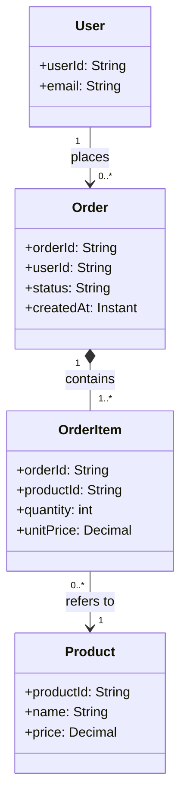

### Database fundamentals

Databases are where the application stores durable data.

#### Relational vs NoSQL databases

Relational databases use structured tables and relationships.

Best for:

- transactions
- strong consistency
- relational queries

Examples:

- PostgreSQL
- MySQL
- SQL Server

NoSQL databases focus on flexible schemas and scale.

Best for:

- unstructured data
- high write throughput
- large-scale analytics

Examples:

- MongoDB
- Cassandra
- Redis
- DynamoDB

Example:

- A banking app usually uses a relational database; a chat history system may use a NoSQL store or hybrid storage design.

#### Entity relationship modeling

This is the process of identifying entities and their relationships.

Example:

- `User` has many `Orders`
- `Order` contains many `OrderItems`
- `Product` belongs to a `Category`

#### UML class diagram: simple order schema



Read `1` to `0..*` as “one user may place zero or many orders.” Composition (`*--`) says order items belong to an order and should not outlive it.

#### Normalization and denormalization

Normalization reduces duplication and preserves correctness.

Denormalization intentionally duplicates data to improve read performance.

Example:

- In an e-commerce app, product details may be normalized into multiple tables, but search results may be denormalized for faster reads.

#### Primary and foreign keys

- primary key uniquely identifies each row
- foreign key references a row in another table

Example:

- `user_id` in `Orders` is a foreign key to `Users.id`.

#### Indexing concepts

Indexes improve read performance by speeding up lookup, sort, and join operations.

Tradeoff:

- faster reads
- slower writes
- more storage usage

Example:

- Adding an index on `email` helps look up users by email much faster.

#### Query optimization basics

Query optimization focuses on reducing expensive database work.

Common ideas:

- avoid full-table scans where possible
- add indexes on frequent query columns
- reduce unnecessary joins
- paginate large result sets
- use projections instead of selecting all columns

Example:

- Instead of selecting all columns from a large table, fetch only the fields required for the page.

#### Beginner SQL example

This schema uses primary keys to identify rows and foreign keys to enforce relationships. `DECIMAL` is used for money rather than floating-point types.

```sql
CREATE TABLE users (
	user_id VARCHAR(40) PRIMARY KEY,
	email VARCHAR(255) NOT NULL UNIQUE
);

CREATE TABLE products (
	product_id VARCHAR(40) PRIMARY KEY,
	name VARCHAR(200) NOT NULL,
	price DECIMAL(10, 2) NOT NULL
);

CREATE TABLE orders (
	order_id VARCHAR(40) PRIMARY KEY,
	user_id VARCHAR(40) NOT NULL REFERENCES users(user_id),
	status VARCHAR(30) NOT NULL,
	created_at TIMESTAMP NOT NULL
);

CREATE TABLE order_items (
	order_id VARCHAR(40) NOT NULL REFERENCES orders(order_id),
	product_id VARCHAR(40) NOT NULL REFERENCES products(product_id),
	quantity INTEGER NOT NULL CHECK (quantity > 0),
	unit_price DECIMAL(10, 2) NOT NULL,
	PRIMARY KEY (order_id, product_id)
);

INSERT INTO users (user_id, email)
VALUES ('USER-1', 'learner@example.com');

INSERT INTO products (product_id, name, price)
VALUES ('P-101', 'Trail Shoes', 49.95);

INSERT INTO orders (order_id, user_id, status, created_at)
VALUES ('ORD-1', 'USER-1', 'PAID', '2026-10-11 10:00:00');

INSERT INTO order_items (order_id, product_id, quantity, unit_price)
VALUES ('ORD-1', 'P-101', 2, 49.95);

CREATE INDEX orders_by_user_and_time ON orders(user_id, created_at);

SELECT o.order_id, o.status, p.name, i.quantity, i.unit_price
FROM orders o
JOIN order_items i ON i.order_id = o.order_id
JOIN products p ON p.product_id = i.product_id
WHERE o.user_id = 'USER-1'
ORDER BY o.created_at DESC;
```

With the four sample rows above, the query returns:

| order_id | status | name        | quantity | unit_price |
| -------- | ------ | ----------- | -------: | ---------: |
| ORD-1    | PAID   | Trail Shoes |        2 |      49.95 |

The index matches the common query pattern: find a user's orders and sort them by creation time. Indexes speed matching reads but consume space and add work to inserts and updates.

#### Using AI to suggest schema improvements

AI can review a schema and suggest:

- missing indexes
- redundant columns
- better relationships
- table splitting
- denormalization opportunities
- query-level improvements

Example prompt:

- “Review this e-commerce schema and suggest improvements for high-read product search queries.”
