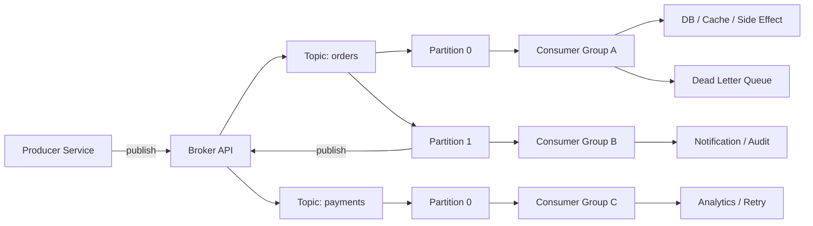
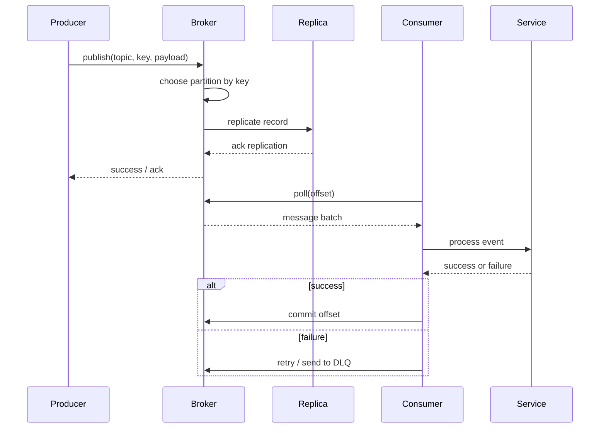
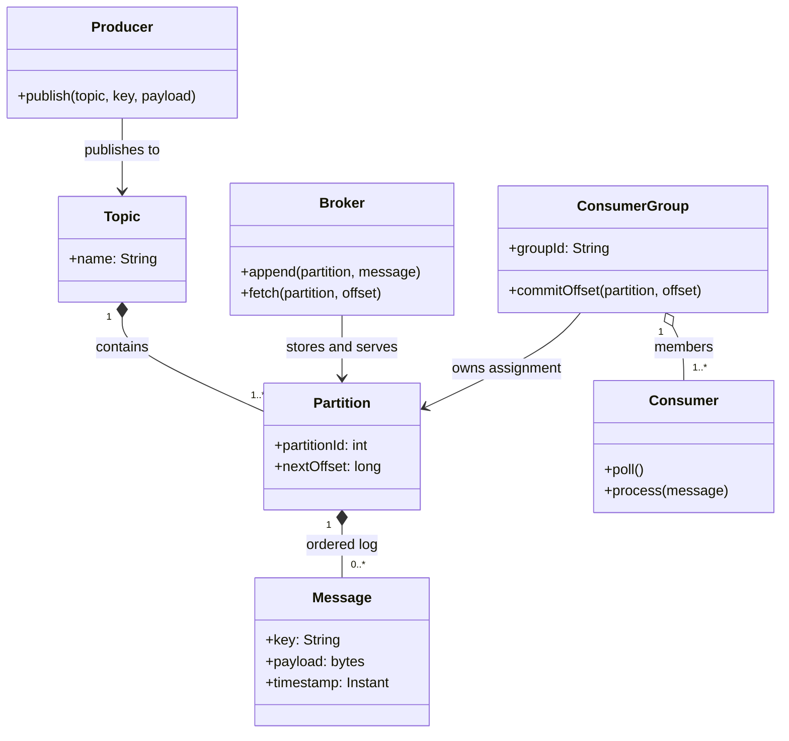

## Message queues and event-driven architecture

### Message Queue Basics

A message queue is a communication mechanism that allows different parts of a system to exchange data asynchronously.

Instead of service A calling service B directly and waiting for the result, A can place a message in a queue and return immediately. Service B processes the message later.

This helps with:

- decoupling services
- improving resilience
- handling bursts of requests
- protecting downstream systems from overload

### Benefits of Queues

Queues help a system stay responsive under load by separating producers from consumers.

Examples:

- order created event
- payment success event
- user signup event
- email notification job

### Synchronous vs Asynchronous

#### Synchronous communication

In synchronous communication, the caller waits for the callee to respond before continuing.

Examples:

- HTTP request to an API
- RPC call
- direct database transaction in the same request flow

Pros:

- simpler to reason about
- immediate feedback
- good for user-facing interactive flows

Cons:

- tight coupling
- slower if downstream is slow or unavailable
- can amplify failures under load

#### Asynchronous communication

In asynchronous communication, the caller sends a message and continues without waiting for an immediate response.

Examples:

- queue-based processing
- event streaming
- background jobs

Pros:

- more resilient
- decoupled services
- better for spikes and retries
- allows background processing

Cons:

- harder to debug
- eventual consistency
- needs retry and monitoring logic

### Kafka as a Log

Kafka is a distributed event streaming platform designed for high-throughput, durable, and scalable messaging.

It is often used for:

- event logs
- real-time data pipelines
- async service communication
- analytics and monitoring pipelines

A Kafka topic is effectively an append-only log: records are written in order, retained durably, and can be replayed by consumers.

This makes Kafka different from a simple mailbox queue. It is designed for durable event history, not just short-lived task delivery.

### Kafka Core Concepts

Core Kafka ideas:

- events are written to topics
- topics are split into partitions
- producers publish to topics
- consumers read from partitions
- Kafka stores records durably and can replay them

Kafka is commonly used when you need:

- large-scale event processing
- decoupled microservices
- change data capture or stream processing
- real-time analytics

### Partitions and Consumer Groups

A topic is divided into partitions, and each partition is ordered independently.

This gives Kafka:

- horizontal scalability
- parallel consumer processing
- fault-tolerant replication
- ability to scale out reads and writes

A consumer group allows multiple consumers to share a topic while each partition is processed by only one consumer in the group. This is how Kafka achieves parallelism without losing ordering within a partition.

### Delivery Guarantees

Kafka provides delivery semantics that are more nuanced than a simple queue.

Typical guarantees include:

- producer writes are stored durably in the topic
- consumers track offsets to know where they stopped
- messages may be delivered again after crashes or rebalances
- the system is usually designed around at-least-once semantics unless the app adds deduplication

This is why Kafka is strong for event pipelines but not inherently a transactional database.

### Idempotency

Idempotency is the ability to process the same message multiple times without changing the result.

In Kafka systems, retries and replays are common, so consumers must usually be safe to run more than once.

Common patterns:

- deduplication keys using message IDs
- storing processed message IDs in a database or cache
- making side effects safe to re-run
- designing business actions to be idempotent

The practical rule is: use at-least-once delivery with idempotent consumers.

### CAP trade-offs

In distributed messaging systems, the CAP theorem says a system cannot fully optimize for all three of:

- Consistency: every reader sees the latest committed value
- Availability: requests are served even during failures
- Partition tolerance: the system keeps working when networks split

In practice, message queues usually choose a trade-off:

- Kafka prioritizes partition tolerance and availability while offering strong durability and eventual consistency
- systems that require strict global ordering or immediate consistency may sacrifice availability or throughput
- in most async architectures, availability and partition tolerance are more important than absolute synchronous consistency

A simple rule is:

- if data loss is unacceptable, prefer stronger durability and replication
- if low latency is critical, accept some eventual consistency and retry logic
- if ordering matters, reduce partition fan-out and keep the same key routed to the same partition

### Ordering and Consistency

Ordering and consistency are different but closely related concerns.

#### Ordering

Ordering means messages with the same key are processed in the same sequence they were produced.

Examples:

- order events for the same user
- ledger or payment actions for a single account
- events for one device or session

Kafka provides ordering within a partition, not across all partitions.

#### Consistency

Consistency means consumers see the latest valid state after a write becomes visible.

Typical consistency patterns:

- strong consistency: reads immediately reflect recent writes
- eventual consistency: all replicas converge after some delay
- read-your-own-writes: the producer can read its newly written result quickly

For message queues, the system often accepts eventual consistency because the queue is designed for asynchronous processing rather than synchronous transaction completion.

### Durability and Persistence

Durability is about whether messages survive crashes, restarts, or broker failures.

In durable queues:

- messages are written to disk or replicated before acknowledgment
- consumers can replay messages after failure
- data loss risk is lower

Durability trade-offs:

- in-memory queues are faster but volatile
- disk-backed queues are slower but safer
- replicated logs are more reliable than single-node message stores

Real systems often use:

- append-only logs
- broker replication
- checkpointing and offsets
- dead-letter topics for failed messages

### Scalability and Partitioning

Partitioning is how a topic is split into independent units so it can scale horizontally.

Benefits of partitioning:

- more throughput
- better parallelism
- more consumer concurrency
- reduced contention on a single log

Design considerations:

- one partition does not equal one consumer in a group
- order is preserved only per partition, not globally across partitions
- partition count must be planned carefully because it affects scaling and rebalancing
- too many partitions can increase operational complexity

A common rule is to partition by business key such as user_id, order_id, or tenant_id to keep related events together.

### Failure Modes and Edge Cases

Message systems fail in many ways, and good design must account for them.

Common failure modes:

- broker crash before message commit
- consumer crashes after reading but before processing completes
- network partition between producer and broker or broker and consumer
- duplicate delivery after retries
- slow consumer causing lag behind the topic log
- poison messages that always fail and block the queue

Common mitigations:

- retry with exponential backoff
- dead-letter queues
- idempotent consumer logic
- offset commits only after successful processing
- monitoring queue lag and consumer health
- replication and leader failover

### Code Example: Below is a minimal example illustrating basic message publishing and consuming

```java
import java.util.*;

class MessageQueueDemo {
    static class Message {
        String topic;
        String payload;

        Message(String topic, String payload) {
            this.topic = topic;
            this.payload = payload;
        }
    }

    static class Producer {
        private final List<Message> queue = new ArrayList<>();

        void publish(String topic, String payload) {
            queue.add(new Message(topic, payload));
            System.out.println("Published to " + topic + ": " + payload);
        }
    }

    static class Consumer {
        private final List<Message> queue;

        Consumer(List<Message> queue) {
            this.queue = queue;
        }

        void consume() {
            if (queue.isEmpty()) {
                System.out.println("No messages available");
                return;
            }

            Message msg = queue.remove(0);
            System.out.println("Consumed from " + msg.topic + ": " + msg.payload);
        }
    }

    public static void main(String[] args) {
        Producer producer = new Producer();
        Consumer consumer = new Consumer(producer.queue);

        producer.publish("orders", "OrderCreated: 101");
        producer.publish("payments", "PaymentSucceeded: 5001");

        consumer.consume();
        consumer.consume();
    }
}
```

This example is intentionally simple. Real systems add persistence, acknowledgements, retries, partitions, and consumer groups.

Beginner walkthrough:

1. `Producer.publish` creates a `Message` and appends it to the in-memory list.
2. The topic label categorizes the message; it does not create a separate list in this toy implementation.
3. `Consumer.consume` removes the oldest message and prints its topic and payload.
4. If the list is empty, the consumer reports that there is no work.

The shared Java list is only a teaching stand-in for a broker. It loses messages on process restart, has no consumer offsets or acknowledgements, and is not thread-safe. The Kafka UML and broker sequence diagram below show the additional concepts a production event log provides.

Expected output from the in-memory example:

```text
Published to orders: OrderCreated: 101
Published to payments: PaymentSucceeded: 5001
Consumed from orders: OrderCreated: 101
Consumed from payments: PaymentSucceeded: 5001
```

### Trade-offs and Design Considerations

Choosing the right message queue system and configuration involves balancing several factors:

- Latency vs. durability: In-memory queues offer speed but risk data loss; persistent queues are slower but safer.
- Throughput vs. ordering guarantees: Relaxing ordering enables higher throughput but can complicate consumer logic.
- Complexity vs. features: Advanced features like transactions, delayed messages, and dead-letter queues add complexity but improve robustness.
- Scaling strategy: Partitioning and replication improve scalability and fault tolerance but require careful coordination.

A practical design often follows this rule:

- keep the queue durable enough for recovery
- keep the consumer idempotent enough for retries
- keep partitioning aligned with business keys
- keep observability on queue lag, processing time, and failure depth

### Producer and Consumer API

#### Producer

A producer sends data to Kafka by writing events to a topic.

Examples:

- order service sends OrderCreated
- inventory service emits StockUpdated
- payment service publishes PaymentSucceeded

#### Consumer

A consumer reads events from a topic and processes them.

Consumers may be:

- a single consumer app
- a consumer group with multiple instances
- a processor reading from many partitions

#### Topic

A topic is a category or stream of events.

Examples:

- user-signup-events
- payment-events
- recommendation-events
- billing-audit-events

Topics help organize event streams by domain or use case.

### At-least-once vs exactly-once delivery

#### At-least-once delivery

The message is delivered one or more times, but it may be retried if there was no acknowledgement.

This means:

- the message may be processed more than once
- duplicates are possible
- the system must be idempotent

Good for many systems where duplicate handling is acceptable or recoverable.

#### At-most-once delivery

The message is delivered zero or one time.

This is fast, but it can lose messages if a failure happens before acknowledgement.

#### Exactly-once delivery

Exactly-once means the message is processed once and only once, even in distributed systems with retries and failures.

In practice, exact-once is hard to achieve in distributed systems.

Many systems aim for:

- at-least-once delivery with idempotent processing
- deduplication keys
- transactional writes
- offset tracking

This is often the correct engineering tradeoff in real systems.

### Event-Driven Architecture

Event-driven architecture (EDA) is based on events that describe what happened, not commands that tell another component exactly what to do.

A producer emits an event such as:

- OrderPlaced
- UserRegistered
- PaymentFailed

Consumers react to those events.

Benefits:

- loose coupling
- easier scaling
- better support for background processing
- flexible reaction to new workflows

Common patterns:

- event producer -> message broker -> event consumer
- event-driven microservices
- async workflows with retry and dead-letter queues

Example:

- user registers
- auth service emits UserRegistered
- onboarding service sends welcome email
- analytics service records the action
- billing service triggers trial setup

### Async AI Pipelines

AI pipelines often use queues and event streams to decouple model inference, data ingestion, and workflow orchestration.

Typical flow:

- user submits request
- API service validates input
- message is queued for AI processing
- worker consumes the job
- model runs inference
- result is stored or published to another topic
- downstream service sends notification or UI update

Why queues matter in AI systems:

- inference workloads are bursty
- model calls may be slow
- retries are common
- background jobs avoid blocking user requests
- one failure should not bring down the entire system

Example architecture:

- API layer accepts requests
- message queue holds jobs
- worker pool runs model inference
- results go to Redis, database, or another topic
- monitoring tracks latency, queue depth, and failure rates

AI system design often includes:

- input validation
- retry policies
- model versioning
- asynchronous inference jobs
- observability and tracing
- dead-letter queues for failed jobs

### High-Level Design (HLD)

A high-level message queue design usually contains these major components:

- producer services that emit events or tasks
- broker or cluster that accepts and stores messages
- topics and partitions that distribute load
- consumer services or worker pools that process messages
- offset tracking and replay support
- monitoring, retries, and dead-letter handling

A typical architecture looks like this:



### Write path (producer to broker)

1. Producer sends a message with topic and optional key.
2. Broker validates request, schema, and auth.
3. Partitioner decides which partition to write to.
4. Leader broker appends the message to the partition log.
5. Replicas sync the record for durability.
6. Broker acknowledges the write after the required replication level is met.
7. Producer can retry safely because the system is designed to be idempotent or replay-safe.

### Read path (consumer from broker)

1. Consumer fetches messages from its assigned partition.
2. Consumer tracks a committed offset.
3. Message is processed by business logic.
4. On success, offset is committed.
5. On failure, the message is retried or moved to a dead-letter topic.
6. Monitoring tracks lag, retries, and throughput.

### Low-Level Design (LLD)

At the module level, the important design abstractions are:

- Message: contains topic, key, payload, timestamp, headers, and metadata
- Topic: logical stream of messages
- Partition: ordered log segment for load distribution
- Producer: writes to a topic with partition strategy
- Consumer: polls and processes records by offset
- Broker: owns storage, replication, and fetch logic
- Offset store: records which messages were processed
- Dead-letter queue: stores repeatedly failing events for investigation

A simplified LLD flow looks like this:



### LLD design notes

- Partitioning by key preserves ordering for related events.
- Consumer groups allow parallelism without duplicate work in the same partition.
- Offsets provide replay capability after restarts.
- Retries must be idempotent to avoid double-charging or duplicate processing.
- A dead-letter queue is critical for poison messages and operational debugging.
- Logs are append-only, which makes writes cheap and sequential.

### UML class diagram: Kafka-style messaging



The minimal publish/consume code example earlier in this guide models only an in-memory FIFO list. It is useful for learning producer/consumer roles, but it does not model Kafka durability, partitions, offsets, replication, or consumer-group rebalancing; those are shown in the HLD/LLD diagrams and described above.

### Design takeaway

For a messaging system, the high-level design is about the flow of data across services, while the low-level design is about how partitions, offsets, retries, and acknowledgements are implemented. The core engineering challenge is balancing ordering, durability, throughput, and failure recovery.

### Interview perspective

For system design interviews, important points are:

- synchronous calls are simpler but tightly coupled
- asynchronous communication improves resilience and scalability
- Kafka is useful for high-throughput event streams
- topics, producers, and consumers form the core model
- at-least-once is common, while exactly-once is expensive and more complex
- event-driven architecture supports decoupling and growth

### Interview answer: Kafka design in 2 minutes

I would design the system around an append-only log. Producers write events to a topic, the broker stores them durably in partitions, and consumers read from their offset. I would use a key to route related events to the same partition so ordering is preserved per key. The consumer group pattern gives parallelism while keeping each partition processed by one consumer at a time. For failures, I would rely on retries, idempotent processing, and dead-letter queues rather than trying to force exactly-once everywhere. This makes the system resilient, scalable, and easy to replay after outages.

In one line: Kafka is a durable, partitioned event log optimized for high-throughput async processing, replay, and decoupled services.
