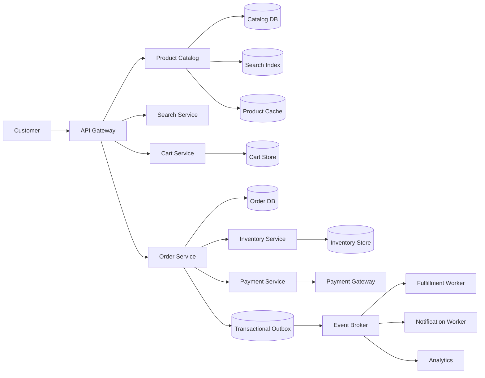
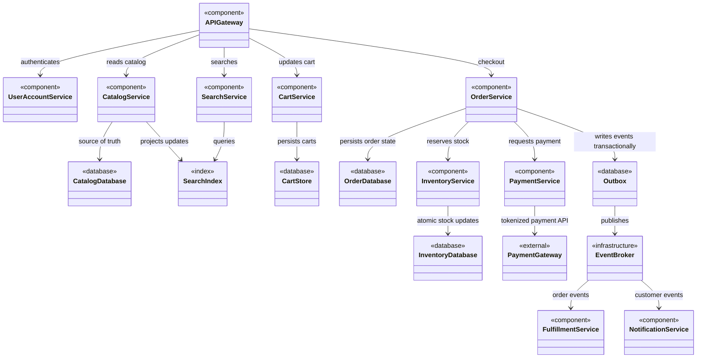
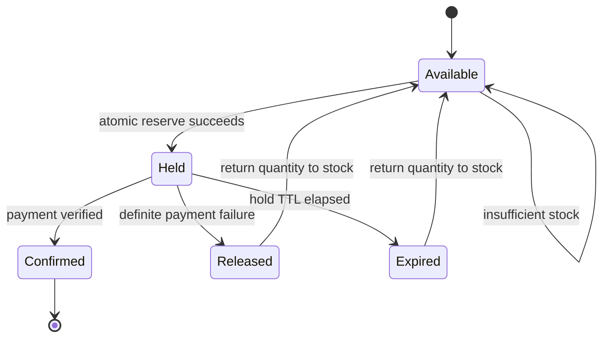
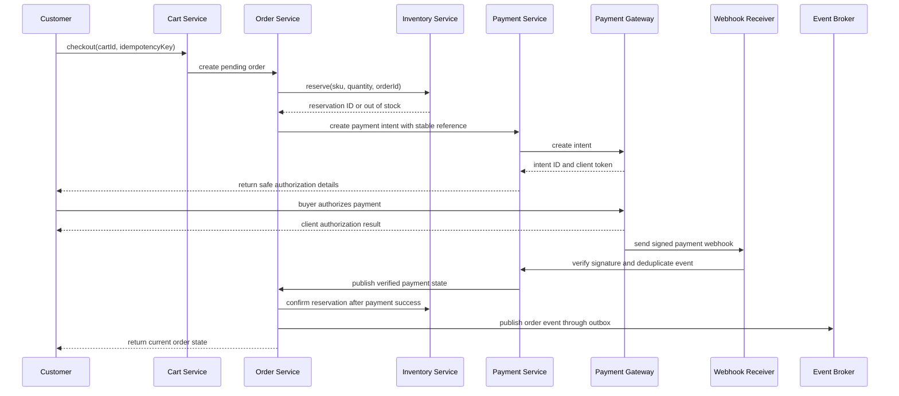
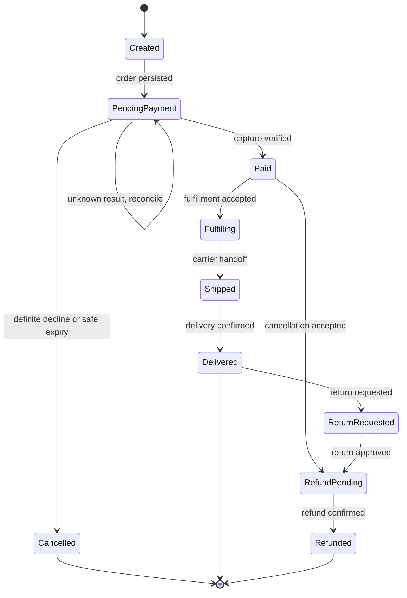
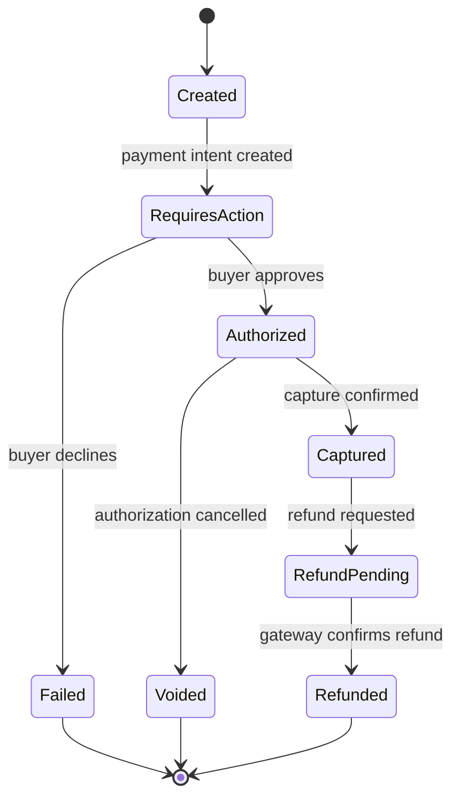
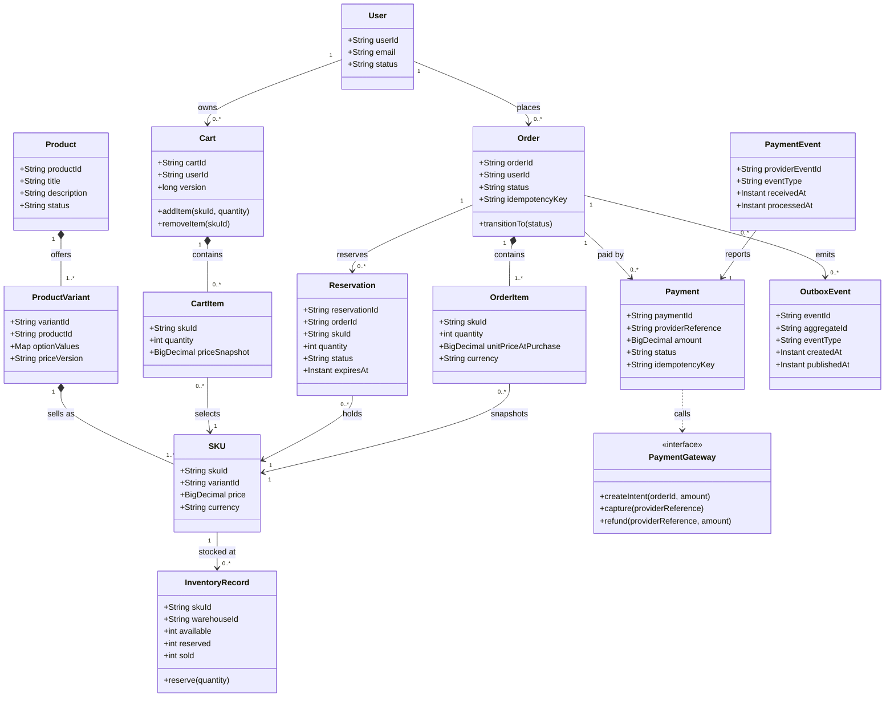
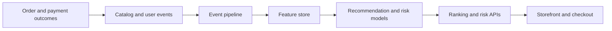

# E-Commerce System Design

Design a shopping platform that lets customers browse products, manage carts, place orders, pay safely, and receive purchases. The central challenge is to keep the critical checkout path correct while catalog reads and flash-sale traffic scale independently.

## E-commerce Checkout System Design

Use this topic map to follow the attached visual sequence from browsing through checkout and recovery:

1. [Catalog Design](#product-catalog-design): read-heavy product pages, search indexes, and cache.
2. [Cart System](#cart-system): guest/session carts versus persistent signed-in carts.
3. [Inventory and Reservations](#inventory-management-and-flash-sales): overselling races, atomic updates, and reservation timing.
4. [Payment Flow](#payment-gateway-flow): gateway authorization, capture, and webhook confirmation.
5. [Idempotency and Safe Retries](#idempotency-and-safe-retries): stable request keys and replay-safe outcomes.
6. [Order Lifecycle as a State Machine](#order-lifecycle): legal, auditable, recoverable transitions.
7. [Distributed Transactions and Sagas](#distributed-transactions-and-sagas): compensating actions across services.
8. [Consistency Trade-offs](#consistency-trade-offs): strong guarantees for critical writes, eventual projections for read models.
9. [AI in E-commerce](#ai-in-e-commerce): recommendations, fraud signals, and demand forecasts around the transactional core.

The attached images provide visual references for these topics: catalog read paths and storage separation, guest and persistent carts, overselling causes, reservation timing, payment and webhook steps, idempotency keys, order state transitions, saga recovery, and consistency choices. The module below supplies the detailed written design behind that visual sequence.

## Requirements

### Functional requirements

- Browse, search, and view products and their prices.
- Add, update, and remove cart items.
- Validate price, promotion, and availability at checkout.
- Reserve inventory, authorize or capture payment, and place an order.
- Track fulfillment, cancellation, refunds, and customer notifications.

### Non-functional requirements

- Avoid overselling and duplicate charges.
- Keep catalog reads fast and highly available.
- Handle traffic spikes and hot products.
- Recover from service, network, broker, and payment-provider failures.
- Provide auditable order and payment history.

## High-Level Design (HLD)

### Main components

- API gateway: authentication, throttling, request routing, and idempotency-key propagation.
- User Account: identity, profiles, authentication, and role-based authorization.
- Product Catalog: product descriptions, attributes, images, categories, and price references.
- Search: indexed product documents for text search and filtering.
- Cart: customer shopping intent, including guest carts.
- Order: order creation, lifecycle transitions, and orchestration.
- Inventory: authoritative sellable, reserved, and sold quantities per SKU and warehouse.
- Payment: gateway integration, idempotent authorization/capture, refunds, and reconciliation.
- Event broker: asynchronous order, inventory, fulfillment, and notification events.
- Cache: product/category read acceleration and carefully bounded hot-data caching.
- Fulfillment and Notification workers: shipping and customer communication.



### UML component view

This UML view summarizes ownership and dependencies between the major system components:



### User account management and security

- Keep identity credentials separate from customer profile and order data where practical; model roles such as `CUSTOMER`, `SUPPORT`, and `ADMIN` with least-privilege authorization.
- Store only salted, slow password hashes using a vetted password-hashing library; never store plaintext passwords or reversible password encryption.
- Use secure session or token handling, account recovery controls, optional multi-factor authentication, and rate limits for login and checkout endpoints.
- Encrypt sensitive personal data in transit and at rest, minimize retention, and audit privileged access.
- Use hosted/tokenized payment fields from the gateway. Do not store raw card numbers or security codes; follow the payment provider's PCI scope guidance.
- Validate and authorize every order/cart resource against the authenticated customer to prevent IDOR-style access to another user's cart or order.

### Monolith or microservices

| Architecture     | Strength                                                                               | Trade-off                                                                                             |
| ---------------- | -------------------------------------------------------------------------------------- | ----------------------------------------------------------------------------------------------------- |
| Modular monolith | One deployment and local database transactions; good for a small team or early product | Modules share scaling and release boundaries unless disciplined internally                            |
| Microservices    | Independent ownership and scaling for catalog, cart, inventory, order, and payment     | Adds network failures, distributed consistency, observability, deployment, and operational complexity |

Start with clear module boundaries and extract services when scale, team ownership, or reliability needs justify the added distributed-systems cost. A Java interface around a payment gateway or repository makes a boundary testable without requiring every component to become a separate service.

### Product catalog design

- Keep product descriptions, attributes, images, and category relationships in a catalog source of truth.
- Cache popular product details and category pages; use a search index for text search and filtering.
- Treat price and availability displayed on a product page as a snapshot. Revalidate them at checkout.
- Publish catalog changes to update search and recommendation read models asynchronously. Those projections can be eventually consistent.
- Keep stock authority in Inventory, rather than relying on a cached catalog availability field.

Catalog browsing is typically read-heavy, often with many more reads than writes. Separate storage by responsibility: the catalog database is the source of truth for product data, the search index supports filtering and ranking, and caches or read replicas absorb page-view traffic. Denormalized product-page documents make reads fast, but must be refreshed when catalog data changes. Search results and cached availability are hints, not checkout guarantees.

#### Product, variant, and SKU model

- A `Product` is the customer-facing parent, such as a shirt or phone model.
- A `ProductVariant` represents a selectable configuration such as size, color, or storage capacity.
- A `SKU` identifies the exact sellable variant and is the key used for pricing, inventory, fulfillment, and order lines.
- Variants inherit shared product descriptions and media where appropriate, but may override attributes or images.
- Keep a price version so checkout can explain when the displayed price changed.

Example: a `Product` named “Trail Shirt” can have size/color variants; each sellable size-color combination has a distinct SKU and its own inventory count. The catalog database remains authoritative, search documents are denormalized for filtering/ranking, and cache or read replicas serve hot product-page reads. Each store has one job: the database is the source of truth, search finds candidates, and cache serves hot reads.

### Cart system

A cart represents shopping intent, not a reservation of stock.

- Store cart ID or `user_id`, SKU, quantity, selected options, and update time.
- Support guest carts using an opaque cart ID and merge them after sign-in.
- Make add, update, and remove operations idempotent so network retries do not duplicate changes.
- Revalidate price, discounts, and availability at checkout; clearly report changed or unavailable items.
- Apply cart expiration and cleanup policies, but do not delete order history when a cart expires.

Choose cart storage based on identity and lifetime:

| Cart type            | Typical storage                                                  | Strength                                        | Trade-off                                                |
| -------------------- | ---------------------------------------------------------------- | ----------------------------------------------- | -------------------------------------------------------- |
| Guest/session cart   | Redis or another cache with a TTL, keyed by an opaque session ID | Fast and does not require sign-in               | Can expire or be lost when the session/device changes    |
| Persistent user cart | Durable store keyed by user ID                                   | Survives sessions and supports multiple devices | Requires persistence, conflict handling, and merge rules |

On sign-in, merge guest and persistent carts using explicit quantity and duplicate-item rules. For example, merge matching SKUs by adding quantities only up to purchase limits, then revalidate price and availability. Use a version or conditional update to avoid losing concurrent edits from another device. Do not reserve stock just because an item is placed in a cart unless the business intentionally chooses that policy and has short reservation expiry.

### Inventory management and flash sales

If millions of buyers compete for limited inventory, cached product counts alone cannot prevent overselling. Inventory needs one authoritative atomic decision for each stock unit or allocated stock bucket.

The overselling race occurs when multiple requests read the same available count before any request writes its decrement. Each request can then believe the last unit is available. A reservation step provides a clear atomic winner before payment proceeds.

Typical failure modes are:

- **Read-then-write race:** two checkouts both observe one remaining unit and both attempt to sell it.
- **Flash-sale spike:** many requests for one SKU overwhelm the same inventory key or database row.
- **Cart held forever:** an abandoned cart never releases its stock hold, stranding sellable inventory.
- **No reservation step:** payment/order processing proceeds without a stock claim, risking a negative count or cancellation after payment.

Track quantities as:

```text
available + reserved + sold = sellable inventory
```

For checkout, use a conditional atomic operation such as:

```sql
UPDATE inventory
SET available = available - :quantity,
    reserved = reserved + :quantity
WHERE sku_id = :sku_id
  AND available >= :quantity;
```

Treat the reservation as successful only when the database reports the expected number of updated rows. In practice, implement this in a transaction and store a unique reservation ID, order ID, quantity, and expiration time. Confirm the reservation after successful payment; release it after a confirmed payment failure or safe expiration.

Flash-sale protections:

- Use admission control, a virtual waiting room, per-customer limits, and rate limiting to bound the work reaching the scarce SKU.
- Put excess checkout attempts into a bounded queue rather than allowing an unbounded request spike to overwhelm the inventory store.
- Partition work by SKU where useful, while recognizing a single popular SKU remains a hot key.
- If a single serialized stock counter is still the bottleneck, allocate stock into bounded buckets and atomically reserve within a bucket. Maintain a strict total allocation and reconcile bucket totals to the authoritative stock amount.
- Use cache for fast rejection or display only; never let a stale cache count authorize the final sale.
- Make reservation creation idempotent so retrying the same order does not reserve twice.

Choose when to reserve deliberately:

| Policy                 | Advantages                                                             | Risks                                                                                                        |
| ---------------------- | ---------------------------------------------------------------------- | ------------------------------------------------------------------------------------------------------------ |
| Reserve on add-to-cart | Reduces the chance that a shopper loses scarce stock at checkout       | Abandoned carts lock inventory; requires short TTLs, expiry workers, and fair allocation                     |
| Reserve at checkout    | Keeps stock available to other shoppers until purchase intent is clear | Buyer may discover the item sold out during checkout; simultaneous requests contend at the reservation point |

For most general retail carts, reserve at checkout. For a limited drop, a short, explicitly expiring hold may be appropriate. A waiting room can reduce load and improve fairness, but adds queue delay and may expire customer sessions. Bucketed stock can improve throughput, but makes allocation and reconciliation more complex.

The choice is a fairness and throughput trade-off: a hold on add-to-cart reduces late sold-out surprises but abandoned carts lock stock; a hold at checkout keeps inventory available longer but can reject a buyer after they commit to checkout.

### Atomicity

The inventory change must be one atomic conditional write: check sufficient available quantity and decrement it as one operation. Never implement this as a separate application-level read followed by an unconditional write. Accept the reservation only if exactly the requested inventory update succeeded; otherwise return an out-of-stock or conflict result. Confirm and release operations must also be conditional on the reservation's current state so retries cannot confirm or release it twice.

For one SKU, the conditional update should affect exactly one inventory record; zero updated rows means sold out or a version conflict. For a multi-SKU order, reserve all lines in one database transaction when they share a transactional inventory boundary. If lines span independent stores or warehouses, treat each reservation as a saga step and release earlier reservations if a later line cannot be reserved. The invariant is that no successful reservation makes `available` negative.

#### Inventory reservation UML



### Payment gateway flow

The gateway owns sensitive card handling. The store creates a payment intent/reference on the server, while the buyer authorizes through the provider's secure client flow. Use provider tokens; never store raw card numbers or security codes.

1. Create a pending order and reserve inventory for a short, bounded interval.
2. Payment Service creates a gateway payment intent for the order amount and returns safe client authorization details.
3. The buyer authorizes the payment with the gateway. The app receives a client result, but the server still verifies the final state.
4. Capture payment immediately or later according to policy. Authorization is not necessarily the same as capture or settlement.
5. The gateway sends a signed webhook. Verify its signature, persist/deduplicate its event ID, and process it idempotently.
6. Confirm the inventory reservation and advance the order only after the required payment state is verified. Release the reservation only on a definite failure or safe expiry.
7. If the response or webhook is delayed, keep the order pending and reconcile with the gateway using the same stable payment reference. A timeout does not prove the charge failed.
8. Publish downstream order events through a transactional outbox so a database commit cannot silently lose its corresponding event.

Webhooks may be duplicated or arrive before or after the synchronous response. Both paths must update the same durable state machine safely. Never retry a potentially successful charge with a new payment reference.

#### Synchronous capture or asynchronous webhook

| Approach                                                  | Benefit                                        | Cost / risk                                                              |
| --------------------------------------------------------- | ---------------------------------------------- | ------------------------------------------------------------------------ |
| Wait for authorization/capture before confirming checkout | Simple buyer feedback and straightforward flow | Slow gateway calls block checkout; outages can reduce conversion         |
| Accept a payment-pending order and finish from webhook    | Fast response and resilient async processing   | Order remains pending; webhook delay requires retries and reconciliation |

Show `PENDING` honestly until the outcome is known; submitting a payment request is not proof of a confirmed order.

### Idempotency and safe retries

Retries happen when a client, service, or gateway times out, even if the original operation completed. Use a stable idempotency key for each logical checkout/payment operation.

- The client reuses the same checkout key when retrying the same user action; a new purchase gets a new key.
- The server stores the key, request fingerprint, processing state, and final response durably.
- If the same key and same request arrive again, return the original result instead of creating another order or charge.
- If the key is reused with a different request body, reject it as a conflict.
- Use stable provider references for payment retries and store provider event IDs to deduplicate webhook delivery.
- Keep idempotency records long enough to cover client retries, gateway retries, and reconciliation windows.

Idempotency does not make a multi-service workflow atomic. It makes individual steps safe to repeat and is used together with explicit state transitions and saga recovery.

Example server-side behavior:

```text
key = (customer_id, idempotency_key)
if key exists:
    if stored_request_hash != hash(request): return conflict
    if stored_result is complete: return stored_result
    return current_operation_status

atomically claim key and create or link the order
run or resume the operation
persist final result under the same key
return final result
```

The key claim and order creation need a uniqueness constraint or equivalent atomic operation. A check-then-insert alone can let two simultaneous retries create duplicate orders.

### Checkout sequence



### Order lifecycle

Use explicit state transitions with validation and audit history:

```text
CREATED -> PENDING_PAYMENT
PENDING_PAYMENT -> PAID                 (verified capture/payment event)
PENDING_PAYMENT -> CANCELLED            (definite failure or safe expiry)
PAID -> FULFILLING -> SHIPPED -> DELIVERED
PAID -> REFUND_PENDING -> REFUNDED
SHIPPED -> RETURN_REQUESTED -> REFUNDED  (if return policy allows)
```

#### Order state UML



Keep payment and order state machines related but separate. Payment may be `REQUIRES_ACTION`, `AUTHORIZED`, `CAPTURED`, `FAILED`, or `REFUNDED`; order may be `PENDING_PAYMENT`, `PAID`, `FULFILLING`, `SHIPPED`, or `CANCELLED`. Do not mark an order `PAID` merely because a payment intent was created or authorized if capture is required by the business flow.

#### Payment state UML



Cancellation and refund are compensating actions; preserve the original order and payment records. Every transition should be safe to retry, validate its current state, and record who or what caused it. A timeout moves the order to a pending/reconciliation path, not to a guessed success or failure.

Model each transition as a guarded command: check the current state, perform the business action, persist the next state and an audit/outbox event, then acknowledge success. For example, `PENDING_PAYMENT -> PAID` is valid only when the required payment event is verified and the matching inventory reservation remains confirmable. A timeout should leave the order in a recoverable pending state, not force a guessed success or failure. A repair/reconciliation worker can inspect pending orders and query inventory and payment providers.

### Distributed transactions and sagas

Checkout spans the order database, inventory store, and an external payment gateway. A normal database transaction cannot atomically commit all of them. Model checkout as a saga: a sequence of local transactions, each with an idempotent compensating action.

| Step              | Forward action                              | Compensation or recovery                                                   |
| ----------------- | ------------------------------------------- | -------------------------------------------------------------------------- |
| Create order      | Persist `PENDING` order and idempotency key | Return the same order on retry; expire abandoned pending orders            |
| Reserve stock     | Create a TTL-bound inventory reservation    | Release reservation if a later step definitely fails                       |
| Authorize payment | Authorize with stable provider reference    | Void authorization or refund if the order cannot proceed                   |
| Confirm order     | Persist `CONFIRMED` and outbox event        | Reconcile and retry event publication from the outbox                      |
| Fulfill           | Start picking and shipment                  | Cancel fulfillment where possible; otherwise initiate return/refund policy |

Do not compensate on an unknown payment outcome. Query or reconcile the gateway first; otherwise releasing stock while a charge succeeded can leave the customer charged without an order. The outbox and idempotent consumers make event delivery retryable, but downstream effects remain asynchronous.

#### Recovery example: charge succeeds while Order Service is down

1. The gateway captures payment and sends a signed webhook while Order Service is temporarily unavailable.
2. Persist the webhook in a durable inbox/event table before acknowledging it; if persistence fails, allow the gateway to retry.
3. A worker retries the event using its original provider event ID. The handler deduplicates it and checks current order/payment state.
4. When Order Service recovers, it applies the payment transition idempotently, confirms the still-valid inventory reservation, and writes the order event to its outbox.
5. If the reservation expired or stock cannot be fulfilled, run the defined compensation: void an authorization or refund captured funds, then record cancellation or manual review.

This is eventual recovery, not a distributed ACID transaction. The outbox handles publishing locally committed changes; an inbox/deduplication record handles repeated inbound webhook or broker events.

## Low-Level Design (LLD)

### Core components

| Component            | Responsibility                                                                                     |
| -------------------- | -------------------------------------------------------------------------------------------------- |
| `CatalogService`     | Fetch product details and publish catalog updates.                                                 |
| `CartService`        | Validate cart mutations and merge guest and signed-in carts.                                       |
| `InventoryService`   | Atomically reserve stock, confirm reservations, and release expired or failed reservations.        |
| `OrderService`       | Validate checkout, create orders, coordinate inventory and payment, and persist state transitions. |
| `PaymentService`     | Authorize, capture, refund, and reconcile payments with a stable provider reference.               |
| `OutboxPublisher`    | Publish committed outbox records to the broker and retry delivery.                                 |
| `FulfillmentService` | Start and track picking, packing, shipment, and delivery.                                          |

### Core entities and attributes

| Entity            | Important attributes                                                                           | Purpose                                                 |
| ----------------- | ---------------------------------------------------------------------------------------------- | ------------------------------------------------------- |
| `Product`         | `productId`, `title`, `description`, `categoryIds`, `mediaIds`, `status`                       | Shared parent/catalog information.                      |
| `ProductVariant`  | `variantId`, `productId`, `optionValues`, `priceVersion`, `status`                             | Selectable size/color/capacity configuration.           |
| `SKU`             | `skuId`, `variantId`, `barcode`, `price`, `currency`, `status`                                 | Exact sellable item keyed by inventory and order lines. |
| `Cart`            | `cartId`, `userId`, `version`, `updatedAt`                                                     | Customer's mutable shopping session.                    |
| `CartItem`        | `skuId`, `quantity`, `selectedOptions`, `priceSnapshot`                                        | Product variant and requested quantity in a cart.       |
| `InventoryRecord` | `skuId`, `warehouseId`, `available`, `reserved`, `sold`, `version`                             | Authoritative inventory counts for a SKU at a location. |
| `Reservation`     | `reservationId`, `orderId`, `skuId`, `quantity`, `status`, `expiresAt`                         | Temporary hold on inventory during checkout.            |
| `Order`           | `orderId`, `userId`, `items`, `amount`, `status`, `idempotencyKey`, `createdAt`                | Purchase record and lifecycle state.                    |
| `OrderItem`       | `orderId`, `skuId`, `quantity`, `unitPriceAtPurchase`, `currency`                              | Immutable purchase-time line and price snapshot.        |
| `Payment`         | `paymentId`, `orderId`, `providerReference`, `idempotencyKey`, `amount`, `status`, `updatedAt` | Gateway payment attempt and reconciliation state.       |
| `PaymentEvent`    | `providerEventId`, `paymentId`, `eventType`, `receivedAt`, `processedAt`                       | Deduplicate and audit asynchronous gateway webhooks.    |
| `OutboxEvent`     | `eventId`, `aggregateId`, `eventType`, `payload`, `createdAt`, `publishedAt`                   | Durable event waiting to be delivered to the broker.    |

### UML domain class diagram

This class diagram connects the catalog, cart, inventory, order, payment, user, and event records. Persistence mapping can differ between a modular monolith and microservices.



### Key operations

- `InventoryService.reserve(orderId, skuId, quantity)`: atomically reserve stock or return unavailable; repeated calls with the same key return the original result.
- `InventoryService.confirm(reservationId)` and `release(reservationId)`: perform valid, idempotent reservation transitions.
- `OrderService.placeOrder(cartId, idempotencyKey)`: create or return the order associated with the idempotency key and coordinate checkout.
- `PaymentService.authorize(orderId, amount, idempotencyKey)`: call the gateway with a stable reference and reconcile uncertain outcomes.

### Example APIs

- `GET /products/{productId}`
- `GET /search?q={query}&filters={filters}`
- `POST /carts/{cartId}/items`
- `PATCH /carts/{cartId}/items/{skuId}`
- `POST /orders` with `Idempotency-Key`
- `GET /orders/{orderId}`
- `POST /orders/{orderId}/cancel`
- `POST /payments/{paymentId}/refund`

Return an explicit out-of-stock or inventory-conflict result from checkout; do not silently lower quantity or report success based on stale data.

### Java implementation example

The runnable [ECommerceCheckoutDemo.java](ECommerceCheckoutDemo.java) demonstrates the object-oriented boundaries with plain Java: immutable product pricing using `BigDecimal`, cart lines, inventory reservation/confirmation/release, a `PaymentGateway` interface, and an idempotent order service.

From the repository root, compile and run it with:

```powershell
javac -d out 25_design_patterns_and_system_design/18_e_commerce_system/ECommerceCheckoutDemo.java
java -cp out ECommerceCheckoutDemo
```

Expected output:

```text
Order result: ORD-1001 / PAID
Retry returned same order: true
Gateway captures: 1
Second buyer result: OUT_OF_STOCK
Remaining available stock: 0
```

#### How to read the example

Read the code from the outside inward:

| Class                | Responsibility in this demo                                                            |
| -------------------- | -------------------------------------------------------------------------------------- |
| `Product`            | Immutable description and price for one sellable SKU.                                  |
| `CartLine`           | A product plus quantity; calculates its line total.                                    |
| `ShoppingCart`       | Groups cart lines, validates quantity, and calculates the cart total.                  |
| `InventoryService`   | Owns stock counts and reservation records; decides whether stock can be claimed.       |
| `PaymentGateway`     | Interface describing the operation the order flow needs from a provider.               |
| `DemoPaymentGateway` | Fake provider that returns the same result for a repeated idempotency key.             |
| `Order`              | Snapshot of the items, amount, identity, and current simplified status.                |
| `OrderService`       | Coordinates ownership validation, idempotency, reservation, payment, and final status. |

#### Checkout walkthrough

1. `main` creates a product, adds one unit to `USER-1`'s cart, and gives Inventory exactly one unit for the SKU.
2. `placeOrder` first verifies that the cart belongs to the caller. It then fingerprints the cart contents and checks whether this idempotency key has already been used.
3. A new order gets a unique ID and copies the cart lines. Copying prevents later cart edits from changing the purchase snapshot.
4. For each order line, Inventory checks stock and changes `available` to `reserved`. The check and change happen together inside the synchronized method.
5. If any line cannot be reserved, the service releases earlier reservations and returns `OUT_OF_STOCK`; it does not charge the buyer.
6. When all lines are reserved, the payment gateway captures using a stable key. A declined payment releases the holds. A successful payment confirms each hold and marks this simplified order `PAID`.
7. The service remembers the request fingerprint and resulting order. Repeating the same key and cart returns that order without another capture; using the same key for different cart contents is rejected.

#### Dry run

| Action                                  | Available | Reserved | Sold | Result                                         |
| --------------------------------------- | --------: | -------: | ---: | ---------------------------------------------- |
| Start with one unit                     |         1 |        0 |    0 | Stock initialized                              |
| Reserve for `ORD-1001`                  |         0 |        1 |    0 | Reservation succeeds                           |
| Capture payment and confirm reservation |         0 |        0 |    1 | Order becomes `PAID`                           |
| Retry with `checkout-key-001`           |         0 |        0 |    1 | Existing order returned; capture count stays 1 |
| Second buyer requests the same SKU      |         0 |        0 |    1 | `OUT_OF_STOCK`; no second capture              |

#### Java concepts used

- `final` fields make a `Product` and `CartLine` stable after construction; mutable cart/order state is kept in separate classes.
- `BigDecimal` represents money without the binary rounding problems of `double`.
- `Map<String, ...>` provides lookup by SKU, reservation ID, or idempotency key; `LinkedHashMap` also preserves insertion order for predictable output.
- `synchronized` allows only one thread at a time to execute the guarded operation on the same object. Here it makes the inventory check-and-update atomic within one JVM.
- The `PaymentGateway` interface separates checkout logic from provider details, making the demo gateway replaceable and testable.
- `OrderStatus` is an enum, so code uses a fixed set of named states instead of error-prone status strings.

The demo is intentionally an in-memory, single-JVM teaching example. Its synchronized methods prevent races only inside this process; restart loses state, and `OrderService.placeOrder` holds one coarse lock while it calls the fake payment gateway, which would limit throughput. A production implementation should not hold a database transaction or global lock across a network call. It should persist progress, use database uniqueness constraints and atomic conditional inventory updates, rely on gateway idempotency, verify webhooks, and recover the workflow with an outbox/inbox saga. This example does not store real card data or call a real gateway, and it simplifies payment to an immediate success/failure response.

## Consistency and failure challenges

- Inventory reservation needs an atomic strongly consistent decision per SKU or bucket to prevent overselling.
- Catalog and cart views can be stale; revalidate at checkout.
- An external payment gateway cannot join the database transaction. Use a saga with explicit state, idempotent operations, retries, reconciliation, and compensating actions.
- Consumers can receive an event more than once. Deduplicate by event/order ID and make handlers idempotent.
- Use an outbox to coordinate a committed order update with eventual event publication.
- Search, recommendations, and notifications can be eventually consistent; they are not authoritative for payment or inventory.
- During a network partition, CAP trade-offs apply. For stock and payment decisions, fail closed or queue/retry rather than confirm an uncertain sale; noncritical catalog reads may remain available from cache.
- Monitor reservation expiry, payment reconciliation backlog, outbox age, queue lag, inventory conflicts, and hot-SKU request rate.

### Consistency trade-offs

| Data or operation                    | Consistency choice                                       | Reason                                                                                  |
| ------------------------------------ | -------------------------------------------------------- | --------------------------------------------------------------------------------------- |
| Inventory decrement/reservation      | Strong atomic decision per SKU or stock bucket           | A stale write can oversell stock.                                                       |
| Payment state and order transitions  | Durable, guarded, idempotent updates with reconciliation | Duplicate charges or contradictory order states have financial impact.                  |
| Product description and search index | Eventual consistency is usually acceptable               | A brief indexing delay is preferable to slowing catalog writes and reads.               |
| Recommendations and recently viewed  | Eventual consistency                                     | These are personalization signals, not purchase authorization.                          |
| Order history display                | Slight delay may be acceptable, but expose pending state | The customer should not mistake an asynchronous update for a failed or duplicate order. |

During a partition or uncertain dependency failure, preserve correctness for inventory and payment even if checkout must wait or fail temporarily. Continue serving noncritical catalog reads from cache when their freshness policy permits.

## Trade-offs

| Decision                            | Benefit                                             | Cost / risk                                                 |
| ----------------------------------- | --------------------------------------------------- | ----------------------------------------------------------- |
| Strong atomic inventory update      | Prevents overselling                                | Contention on hot SKUs can limit throughput                 |
| Eventual catalog/search projections | Fast, scalable reads                                | Search or display data can lag behind source data           |
| Reservation before payment          | Avoids charging for unavailable stock               | Holds stock during payment latency; requires expiry/release |
| Payment authorization then capture  | Allows checks before final charge                   | More states and gateway integration complexity              |
| Waiting room and bounded queue      | Protects services and improves controlled admission | Adds customer wait time and operational complexity          |
| Stock buckets                       | Parallelizes hot-SKU reservations                   | Requires careful allocation and reconciliation              |

## AI in E-commerce

AI can improve discovery and operations, but it should sit beside the transactional path rather than replace its correctness checks.

- Recommendations and personalized search: rank products from session, purchase, and product signals; serve from a read-optimized index or cache.
- Checkout optimization: detect likely cart abandonment and select appropriate reminders or assistance without changing prices or stock silently.
- Fraud and payment risk: score transactions before authorization or capture; high-risk decisions can request additional verification or manual review.
- Demand forecasting: estimate SKU/warehouse demand to guide replenishment and pre-positioning. Forecasts inform inventory planning but do not create sellable stock.
- Promotion optimization: choose candidate offers subject to explicit pricing, margin, and eligibility rules enforced by deterministic services.

Typical data flow:



Keep hard invariants deterministic: AI may rank products or flag a payment for review, but the inventory service still performs the atomic stock reservation and the payment service still enforces idempotency and records the gateway result. Monitor model quality, drift, latency, fairness, and fallback behavior; use rules or cached recommendations when model services are unavailable.

## Attached image references

The attached visuals correspond to the module sections as follows:

- Overview cards: catalog, cart, inventory, payments, order lifecycle, consistency, trade-offs, and AI.
- Catalog slide: product/variant/SKU model, source-of-truth database, search index, cache, and read replicas.
- Cart slide: guest/session cart versus persistent user cart and merge behavior.
- Inventory slides: read-then-write race, flash-sale hot key, reservation timing, atomic conditional decrement, confirm, and release.
- Payment slides: payment intent, buyer authorization, capture, and asynchronous webhook confirmation.
- Idempotency slide: one stable key per logical operation and replaying the stored result on retries.
- Order and consistency slides: explicit state machine, saga compensation, and strong versus eventual consistency boundaries.
- AI slide: recommendations, checkout optimization, fraud signals, and demand forecasting outside the source-of-truth transaction.

## Interview answer

I would separate catalog, cart, order, inventory, payment, and fulfillment responsibilities. Catalog and search are read-heavy, so I would cache product data and update search indexes asynchronously. At checkout, I would revalidate price and atomically reserve stock in the authoritative inventory store. I would create an idempotent pending order, authorize payment with a stable gateway reference, then confirm the reservation and publish the order event through an outbox. Definite payment failures release the reservation; uncertain timeouts are reconciled before retrying or releasing stock. For flash sales, I would add a waiting room, bounded admission, per-customer limits, and possibly preallocated stock buckets for hot SKUs. This protects the critical invariant against overselling while allowing noncritical read models to be eventually consistent.

## Interview questions

- How do you prevent overselling during a flash sale with millions of concurrent users?
- What should happen if payment succeeds but the response times out?
- Is adding an item to a cart a stock reservation?
- How do you handle a hot SKU or inventory database key?
- Which parts of the system can be eventually consistent?
- How do you make order and payment retries idempotent?
- How would you support multiple warehouses, partial fulfillment, and refunds?

## Test yourself: checkout scenarios

Reason about the mechanism and trade-off, not just the definition.

### Q1: Two buyers, one unit

**Answer:** Use a conditional atomic inventory update that checks `available >= quantity` while decrementing available stock and creating the reservation. One transaction wins the final unit; the other updates zero rows and receives an out-of-stock result. A separate read followed by an unconditional write is unsafe.

### Q2: The gateway retries a charge

**Answer:** Reuse the same payment idempotency key and provider reference for the same logical charge. Persist the request fingerprint and result, and deduplicate webhook event IDs. If the outcome is unknown, query or reconcile with the gateway before retrying; never generate a new key for the same attempted charge.

### Q3: Should inventory be reserved when an item enters the cart?

**Answer:** Usually not. Carts are tentative, and abandoned carts would lock inventory. Reserve at checkout instead. For a limited drop, a short TTL hold can be justified, but it needs expiry, release, purchase limits, and clear behavior when the hold expires.

### Q4: Payment succeeds while Order Service is down

**Answer:** Keep the order pending and persist the signed payment webhook in a durable inbox, deduplicated by provider event ID. Retry processing when Order Service recovers, apply the payment transition idempotently, confirm the still-valid reservation, and publish the order event through the outbox. If the reservation can no longer be honored, void the authorization or refund captured funds and record the compensation.

## Asked in real interviews

| Interview question                                    | Core answer points                                                                                           |
| ----------------------------------------------------- | ------------------------------------------------------------------------------------------------------------ |
| Design an e-commerce checkout system                  | Catalog/search read path, cart, atomic reservation, payment, order states, and async events.                 |
| How do you prevent inventory overselling?             | Conditional atomic decrement, reservation state and TTL, idempotency, and hot-SKU admission control.         |
| How do you make payment retries safe?                 | Stable idempotency key/provider reference, webhook dedupe, and reconciliation for unknown outcomes.          |
| How do you keep cart and inventory consistent?        | Cart is intent; revalidate at checkout, reserve atomically, expire holds, and compensate failures.           |
| Design a product catalog and search                   | Product/variant/SKU model, canonical catalog database, denormalized search index, cache, and read replicas.  |
| How do you recover a distributed checkout?            | Saga local steps, compensating actions, outbox/inbox, idempotent consumers, and repair workers.              |
| Where do you need strong versus eventual consistency? | Strong decisions for stock/payment; bounded eventual consistency for search, recommendations, and analytics. |
