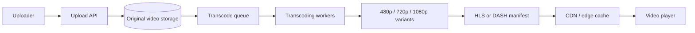
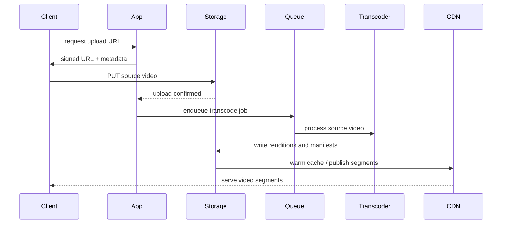
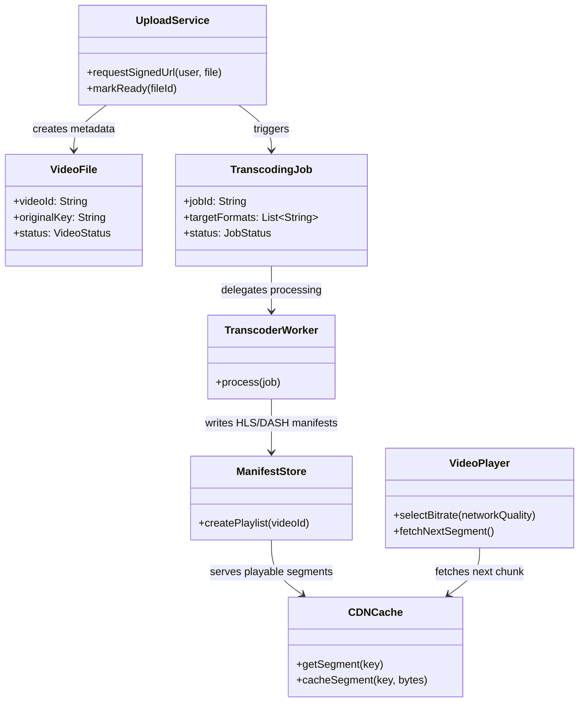
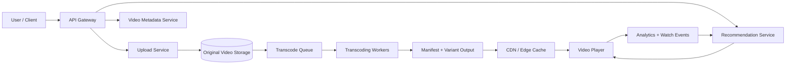
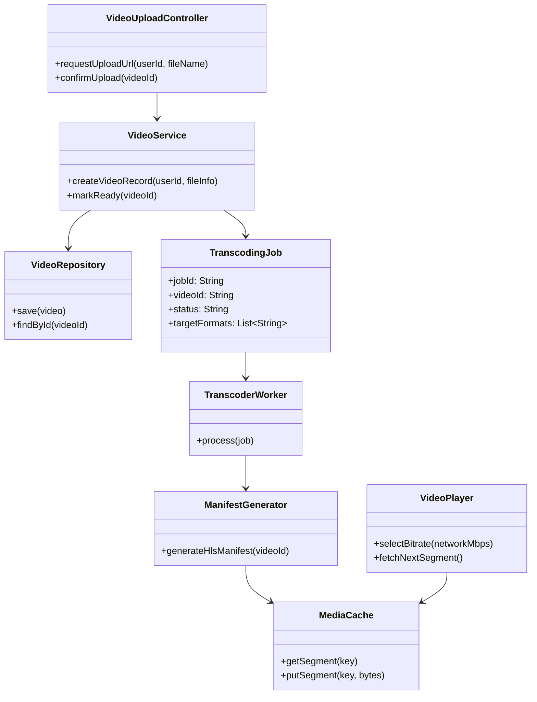
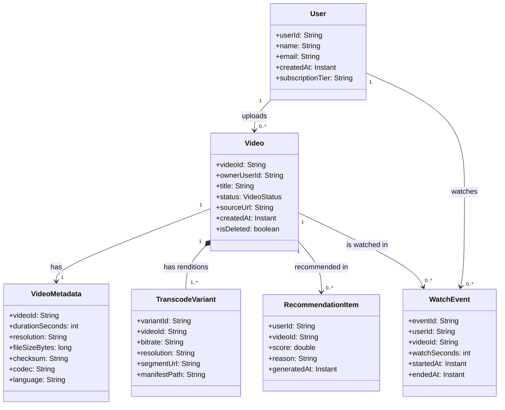
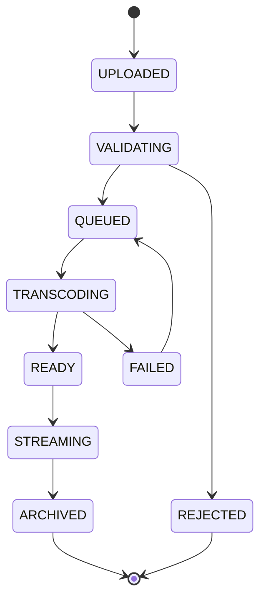

# Video streaming

Video streaming is a media-delivery problem: the system must accept user uploads, prepare playable versions, store them efficiently, and serve them with low latency and good resilience under variable network conditions.

## 1. Why video streaming is different

Video is large, time-sensitive, and expensive to serve at scale. Compared with text or JSON APIs, a streaming system must handle:

- large file uploads
- transcoding into multiple bitrates and resolutions
- chunked delivery for playback
- adaptive bitrate selection
- CDN caching and origin protection
- live and on-demand traffic patterns
- quality-of-service under bandwidth spikes

A plain file upload pipeline is not enough; video systems usually add media-specific storage and processing stages.

---

## 2. Core components

A practical video system usually has:

1. Upload service
   - accepts original source video
   - validates size, MIME type, and authorization
2. Object storage or media bucket
   - stores original source files and generated outputs
3. Transcoding workers
   - convert the source into multiple renditions
4. Manifest generator
   - creates HLS or DASH playlists for adaptive playback
5. CDN and edge cache
   - serve segments near the viewer
6. Playback client
   - fetches the next segment and switches bitrate based on network quality



---

## 3. Upload and processing flow

### Upload flow

The typical upload flow is:

1. client requests a signed upload URL
2. server validates user and file metadata
3. client uploads directly to object storage
4. app server records the file metadata and status
5. a background job starts transcoding
6. output manifests and segments become ready for playback



This flow avoids pushing huge raw bytes through application servers and keeps the app server focused on metadata, auth, and orchestration.

---

## 4. Encoding and transcoding

Encoding means compressing raw source footage into a playable format. Common output choices include:

- H.264 or H.265 video codecs
- MP4 or segment-based formats
- adaptive bitrate profiles
- thumbnails and poster images
- subtitle or audio tracks

Transcoding means generating multiple versions from one source. Example renditions:

- 240p / 360p / 480p / 720p / 1080p
- mobile-friendly bitrate ladder
- low-latency and high-quality profiles
- audio-only variants for podcast or voice content

Production systems often prefer a queue-based media pipeline because encoding can take minutes, not milliseconds.

### Why multiple renditions matter

A viewer on a 4G connection should not be forced to download the same file a user on a fiber connection receives. Adaptive bitrate lets the player choose the best quality based on network conditions and device capabilities.

---

## 5. Streaming protocols

### HLS

HLS is based on HTTP and splits content into small segments with a playlist.

Benefits:

- simple to deploy behind CDNs
- good browser and mobile support
- easy caching and replay

Trade-offs:

- latency is usually higher than WebRTC or low-latency HLS
- segment boundaries affect playback smoothness

### DASH

DASH is an adaptive HTTP streaming standard similar to HLS, but more open and extensible.

Benefits:

- codec flexibility
- fine-grained quality switching
- widely supported by streaming players

### WebRTC

WebRTC focuses on real-time or near-real-time communication.

Best for:

- live meetings
- sports commentary
- interactive streaming
- low-latency communication

### RTMP / RTSP

Older systems often still use RTMP or RTSP, especially for ingest and live broadcast. Many modern systems move to HTTP-based delivery after ingest.

---

## 6. Chunked streaming and progressive delivery

Instead of serving one giant file, the player receives a sequence of short segments. This is how video systems improve resilience and user experience.

Typical flow:

- source video is split into 2–10 second chunks
- each chunk is stored with a manifest and metadata
- client fetches next segment only when needed
- if a segment fails, only that segment is retried

Benefits:

- lower buffering
- resume support after network blips
- simpler CDN caching
- better support for live playback

Example chunk flow:

```text
playlist.m3u8
segment-0001.ts
segment-0002.ts
segment-0003.ts
segment-0004.ts
```

The player reads the playlist, chooses the segment to fetch next, and adapts quality as the network changes.

---

## 7. CDN and edge caching

A CDN is essential for video because the same content is watched by many users at once.

Common CDN patterns:

- cache video segments near the user
- serve static thumbnails and poster images from edge nodes
- invalidate or revalidate on new upload/version
- protect origin storage from repeated replays

This reduces:

- latency
- origin load
- bandwidth cost
- hot-spot failures

The core rule is simple:

- origin is the source of truth
- edge is for fast delivery of hot segments

---

## 8. Live streaming vs VOD

### VOD (video on demand)

- content is already uploaded and stored
- user requests a specific video and plays it on demand
- segments can be pre-generated and cached

### Live streaming

- content is generated and uploaded in real time
- the system must lower ingestion and playback latency
- chunks are created continuously as the stream arrives
- metrics and backpressure matter more

Live pipelines are usually more sensitive to delays, buffering, and ingest spikes.

---

## 9. A beginner-friendly class diagram



This is a design-level view: the upload service orchestration, transcoder workers, manifest generation, and player adapt the same raw video into a scalable delivery pipeline.

---

## 10. High-level design (HLD)

At the system level, the problem is not just storing a file. A video platform must decouple ingest, processing, and playback so each stage can scale independently.



### HLD concerns

- ingest path: upload and metadata validation
- processing path: transcoding and manifest generation
- delivery path: CDN + player + adaptive bitrate selection
- recommendation path: personalized ranking from watch history and user interests
- operational path: retries, queue durability, monitoring, backpressure

### HLD interview answer

> A scalable video platform separates ingestion, processing, and delivery. Users upload source video to an object store via signed URLs, the system enqueues a transcoding job, workers generate multiple renditions and manifests, and a CDN serves the segment files to the client. The player chooses bitrate based on device and network quality. Recommendation logic runs separately from the transactional upload path, so it can be optimized for personalization without slowing down upload or playback.

---

## 11. Low-level design (LLD)

LLD focuses on the classes, responsibilities, and workflows inside one sub-system.



### LLD responsibilities

- `VideoUploadController`: handles API requests and signed URLs
- `VideoService`: coordinates metadata, validation, and readiness updates
- `VideoRepository`: stores searchable metadata and file state
- `TranscodingJob`: tracks video conversion tasks and their outputs
- `TranscoderWorker`: actually encodes multiple variants
- `ManifestGenerator`: creates HLS/DASH playlists and segment metadata
- `MediaCache`: caches segments at edge or application layer
- `VideoPlayer`: chooses bitrate and fetches segments

This is the implementation view behind a large media system. The HLD answers “what pieces exist?” while the LLD answers “what classes and methods coordinate them?”

---

## 12. UML and state flow

### Domain UML with attributes and relationships



This domain model adds the concrete attributes you would usually capture in a media product: who uploaded the video, how long it is, which bitrates exist, what the player saw in a watch event, and which recommendation candidates were ranked for a user.

### State diagram for one video



This state view highlights an important product reality: a video does not become playable immediately after upload. It must be validated, queued, transcoded, and marked ready before the CDNs and player can stream it.

---

## 13. Java demo: adaptive bitrate selection

This small example shows the decision logic behind adaptive bitrate choice. It is intentionally simple and in-memory.

### Related code examples in this module

The main runnable example for this chapter is [VideoStreamingPipelineDemo.java](VideoStreamingPipelineDemo.java). It combines the three beginner flows you asked for:

- upload + transcoding workflow
- recommendation candidate generation
- AI scoring pipeline flow

```java
import java.util.ArrayList;
import java.util.Comparator;
import java.util.HashMap;
import java.util.List;
import java.util.Map;

public class VideoStreamingPipelineDemo {
    public static void main(String[] args) {
        System.out.println("=== Upload + transcoding workflow ===");
        VideoUploadService uploadService = new VideoUploadService();
        String videoId = uploadService.upload("user-42", "travel-reel.mp4");
        uploadService.startTranscoding(videoId);

        System.out.println("\n=== Recommendation candidate generation ===\n");
        User user = new User("user-42", List.of("travel", "food", "technology"));
        RecommendationService recommendationService = new RecommendationService();
        List<String> candidates = recommendationService.generateCandidates(user);
        System.out.println("Candidates for " + user.userId + ": " + candidates);

        System.out.println("\n=== AI scoring pipeline ===");
        AIRecommendationScorer scorer = new AIRecommendationScorer();
        Map<String, Double> scores = scorer.scoreCandidates(user, candidates);
        scores.entrySet().stream()
                .sorted(Map.Entry.comparingByValue(Comparator.reverseOrder()))
                .forEach(entry -> System.out.println(entry.getKey() + " -> score=" + String.format("%.2f", entry.getValue())));
    }

    static final class VideoUploadService { ... }
    static final class User { ... }
    static final class RecommendationService { ... }
    static final class AIRecommendationScorer { ... }
}
```

Expected output:

```text
=== Upload + transcoding workflow ===
Upload accepted for user=user-42, file=travel-reel.mp4, videoId=video-<timestamp>
Queued transcoding job for video-<timestamp> -> [360p, 720p, 1080p]
  generated segment manifest for 360p
  generated segment manifest for 720p
  generated segment manifest for 1080p

=== Recommendation candidate generation ===
Candidates for user-42: [video-101, video-204, video-301, video-500, video-772]

=== AI scoring pipeline ===
video-204 -> score=1.31
video-301 -> score=1.11
video-772 -> score=1.02
video-101 -> score=0.75
video-500 -> score=0.68
```

This example shows how a media product combines three layers of logic:

- the upload path handles user content and transcoding jobs
- the recommendation path narrows candidate videos using interests
- the AI scoring path ranks those candidates based on relevance signals

The exact numeric values are illustrative; the important concept is the staged pipeline.

---

### Standalone adaptive-bitrate demo

This small example shows the decision logic behind adaptive bitrate choice. It is intentionally simple and in-memory.

```java
import java.util.List;

public class VideoStreamingDemo {
    public static void main(String[] args) {
        AdaptiveBitrateSelector selector = new AdaptiveBitrateSelector();

        System.out.println(selector.choose(5.0, 100));
        System.out.println(selector.choose(25.0, 200));
        System.out.println(selector.choose(80.0, 1500));
    }

    static final class AdaptiveBitrateSelector {
        private final List<String> levels = List.of("360p", "720p", "1080p");

        String choose(double networkMbps, int screenWidth) {
            if (networkMbps < 3 || screenWidth < 800) {
                return "360p";
            }
            if (networkMbps < 10 || screenWidth < 1400) {
                return "720p";
            }
            return "1080p";
        }
    }
}
```

Expected output:

```text
360p
720p
1080p
```

This example demonstrates the common idea behind adaptive bitrate selection: choose a lower quality on slower networks or smaller screens, and prefer higher quality when conditions allow.

---

## 11. How this maps to the hand-drawn requirements

Your image shows a product requirement list with these ideas:

- Functional requirements: user can upload videos; user can stream videos
- Non-functional requirements: high availability, large uploads, low-latency streaming, high scale
- Core entities: User, Video, Video metadata
- Design flow: upload -> encode/transcode -> manifest -> stream -> recommendations

This chapter matches that structure directly:

- upload path addresses the functional requirement “users can upload videos”
- streaming path addresses “users can watch/stream videos”
- availability, scale, and low latency map to the NFRs
- `User`, `VideoFile`, `TranscodingJob`, and `VideoPlayer` reflect the core entities in the sketch
- the upload/transcode/recommendation pipeline mirrors the same product flow in a system-design interview

The main takeaway is that a good video platform is not a single service. It is a coordinated pipeline of:

- ingest
- validation
- storage
- transcoding
- manifest creation
- CDN delivery
- recommendation and ranking
- monitoring and retry logic

---

## 12. Interview-ready summary

A good answer for a video streaming interview is:

- upload the source video to object storage or a media bucket
- queue transcoding jobs to generate multiple renditions
- generate HLS or DASH manifests for adaptive playback
- cache segments on a CDN near the user
- select bitrate dynamically based on network and device capabilities
- keep live streams low-latency and on-demand streams cache-optimized

### Typical interview questions

- How do you design a YouTube-like video platform?
- How do you transcode video at scale?
- Why use HLS or DASH instead of serving one raw file?
- How do you handle buffered playback under variable bandwidth?
- What do you cache: segments, manifests, or thumbnails?
- How do you keep live streams low latency without breaking throughput?

## 13. Trade-offs to remember

| Decision | Benefit | Cost / risk |
| --- | --- | --- |
| Multiple renditions | Better playback quality and smoother UX | More storage and transcoding cost |
| CDN edge caching | Lower latency and origin load | Cache invalidation and stale content risk |
| HLS/DASH manifests | Adaptive streaming and simpler delivery | More metadata and more moving parts |
| Chunked segments | Resume and retry without re-downloading whole file | More objects and metadata management |
| Live streaming | Real-time user experience | More sensitive to latency and ingest spikes |

This is the baseline architecture behind OTT, short-video platforms, live broadcasters, and media-heavy apps.