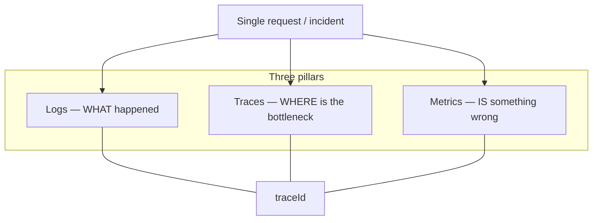
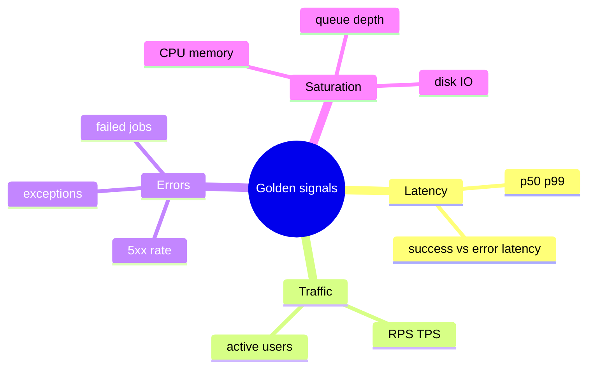
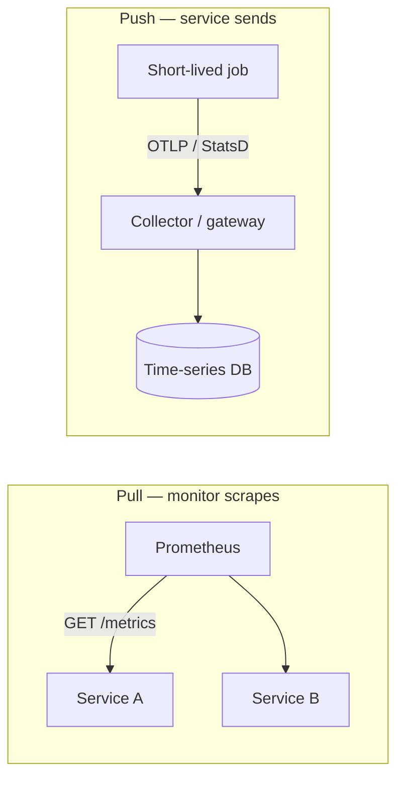
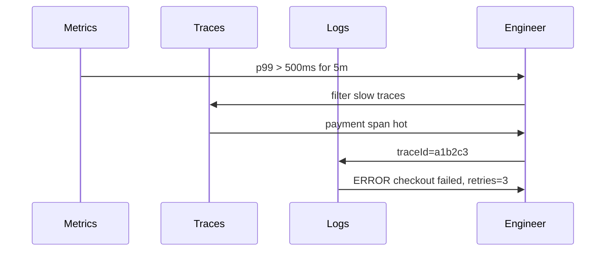
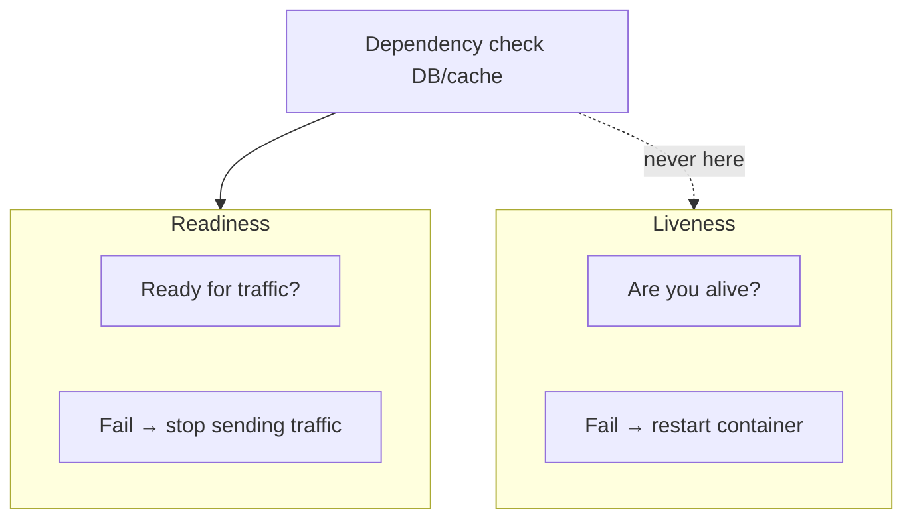
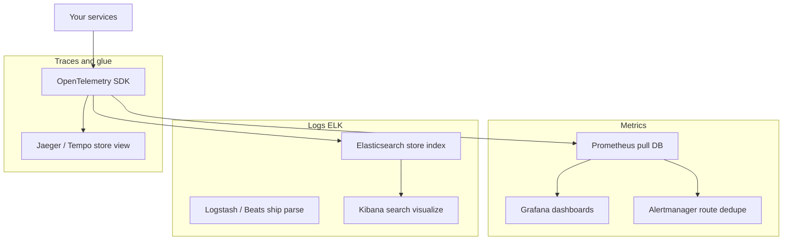
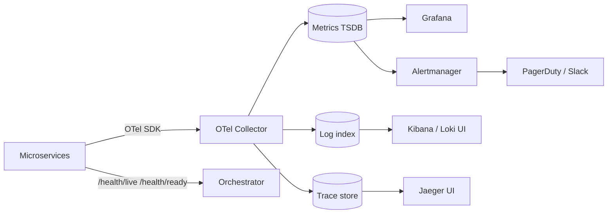
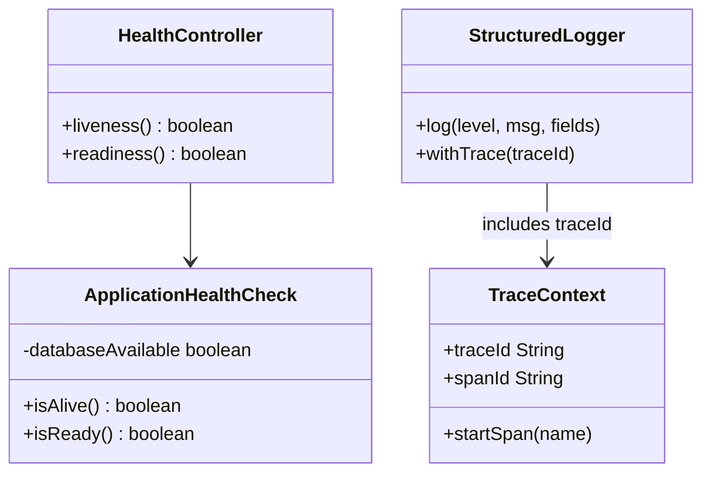

# Observability

**Observability** is the ability to understand what is happening inside a running system from the data it emits — without guessing. You **instrument first**, then **react** with dashboards, alerts, and traces when users or SLOs show pain.

Operating production is not only “did the feature ship?” It is “can we see failures, latency, and saturation before users report them?”

---

## 1. Why observability matters

| Without observability | With observability |
| --- | --- |
| Users report outages first | Metrics and alerts surface symptoms early |
| `grep` across 500 servers | Centralized, searchable logs |
| “Something is slow” | Traces show **which hop** is slow |
| Postmortems lack a timeline | Logs + metrics + traces linked by `traceId` |

**Mantra:** *You can't operate what you can't see.*

---

## 2. Requirements (designing an observability platform)

When interviewers say “design a monitoring / alerting system,” clarify requirements like any other design.

### Functional requirements (FR)

- **Ingest** logs, metrics, and traces from services, agents, and batch jobs.
- **Store and index** data for search, aggregation, and retention policies.
- **Query** by time range, service, severity, `traceId`, user id, etc.
- **Visualize** dashboards (Grafana, Kibana, Jaeger UI).
- **Alert** when user-facing symptoms cross thresholds for a sustained duration.
- **Route notifications** (PagerDuty, Slack) with deduplication and severity.
- **Correlate** pillars via shared identifiers (`traceId`, `service`, `deployment`).

### Non-functional requirements (NFR)

- **Scale:** billions of log lines and high-cardinality metrics per day.
- **Latency:** ingestion should not add noticeable overhead to the app (often &lt; 1–2% with sampling).
- **Durability:** metrics and critical logs survive node loss (replication).
- **Cost:** retention tiers; trace **sampling**; log volume controls.
- **Security:** no secrets/PII in plain logs; RBAC on dashboards.
- **Vendor neutrality:** OpenTelemetry (OTel) as a single instrumentation layer.
- **Reliability:** the observability stack must stay up when apps misbehave (isolated failure domain).

---

## 3. Three pillars: logs, metrics, traces

Observability rests on **three complementary data types**. They answer different questions; mature teams use **all three**, linked by **`traceId`**.



| Pillar | Definition | Best question | Best for | Cost |
| --- | --- | --- | --- | --- |
| **Logs** | Discrete events with context | What happened, exactly? | Debugging a specific failure | High volume, pricey to store |
| **Metrics** | Numbers aggregated over time | Is something wrong, and how much? | Dashboards and alerts | Cheap, no per-request detail |
| **Traces** | One request across many services | Where is the bottleneck? | Latency in microservices | Medium; often sampled |

**Memory hook:** **Metrics** say something is wrong → **Traces** say **where** → **Logs** say **why**.

---

## 4. Logs

### 4.1 Logging levels

Use levels consistently so operators can filter noise:

| Level | Typical use |
| --- | --- |
| **TRACE / DEBUG** | Detailed dev-only flow (avoid in prod at scale) |
| **INFO** | Normal business events (order placed, job started) |
| **WARN** | Recoverable oddity (retry, deprecated API) |
| **ERROR** | Failed operation needing attention |
| **FATAL** | Process or service cannot continue |

**Rule of thumb:** log **INFO** for audit-worthy events; **ERROR** with stack traces for failures; avoid logging secrets or full credit cards.

### 4.2 Plain text vs structured logs

Plain text is easy to write but hard to query at scale:

```text
ERROR user 42 checkout failed after 3 retries at 03:14
```

Structured **JSON** (or key-value) logs are machine-parseable — filter, aggregate, and alert on fields:

```json
{
  "ts": "2026-06-11T03:14:00Z",
  "level": "ERROR",
  "msg": "checkout failed",
  "userId": 42,
  "traceId": "a1b2c3",
  "retries": 3
}
```

Always include **`traceId`** (and often `spanId`, `service`, `deployment`) so logs join traces and metrics in one incident view.

See [ObservabilityDemo.java](ObservabilityDemo.java) for a tiny structured-log printer in Java.

### 4.3 Centralized logging

Per-server log files do not scale. **Ship logs to one searchable place** (ELK, Loki, cloud logging). Agents (Beats, Fluent Bit, OTel collector) tail files or receive stdout and forward with parsing.

---

## 5. Metrics

### 5.1 Four golden signals

Google’s SRE book distills monitoring into four signals. If you watch only four things, watch these:



| Signal | Measures | Examples |
| --- | --- | --- |
| **Latency** | Time to serve a request | Track **p50** and **p99**; split success vs error latency |
| **Traffic** | Demand on the system | Requests/sec, transactions/sec, active users |
| **Errors** | Failed requests | HTTP 5xx, exceptions, failed background jobs |
| **Saturation** | How “full” the system is | CPU, memory, queue depth, connection pools |

**Pitfall:** **Averages lie.** A healthy average can hide terrible **p99** — the slow tail is what users feel.

### 5.2 Metrics collection: push vs pull



| | **Pull** (e.g. Prometheus) | **Push** (e.g. StatsD, OTLP push) |
| --- | --- | --- |
| **How** | Monitor polls `/metrics` on a schedule | Service emits to collector/gateway |
| **Pros** | Monitor controls scrape load; easy to detect dead targets | Works behind NAT; good for **short-lived jobs** |
| **Cons** | Hard through NAT; misses very short jobs | Collector can become a bottleneck if uncontrolled |

Many teams use **pull for long-running services** and **push gateways** for batch/cron work.

---

## 6. Traces

In microservices, one user click **fans out** across many hops. A **trace** is the end-to-end story; each hop is a **span**.

### 6.1 Trace IDs and span linking

| Field | Role |
| --- | --- |
| **`traceId`** | Same for the entire request — **groups all logs and spans** |
| **`spanId`** | Unique id for this hop |
| **`parentId`** | Caller’s `spanId` — builds a **call tree** |

Example span (payment service):

```json
{
  "traceId": "a1b2c3",
  "spanId": "s2",
  "parentId": "s1",
  "service": "payment",
  "durMs": 480
}
```

**Interview fact:** A trace ID lets you **group all logs and spans for a single request** across services — not restart pods, encrypt traffic, or replace CPU metrics.

### 6.2 Sampling vs full tracing

| | **Full tracing** | **Sampling** |
| --- | --- | --- |
| **Idea** | Store every request’s trace | Store a fraction (e.g. 1%) |
| **Pros** | Never miss rare failures; complete debug picture | Cheap, low overhead at scale |
| **Cons** | Huge storage/ingest cost; added latency | May miss rare slow requests if random only |

**Tail-based sampling:** decide **after** the request completes — keep **all errors** and high-latency traces while dropping most successful fast paths. Best of both worlds at billions of requests/day.

---

## 7. Using the pillars together

Typical **latency spike** workflow:

1. **Metrics:** p99 latency alert fires (symptom).
2. **Traces:** find slow traces; inspect spans — **payment** `durMs` is 480ms.
3. **Logs:** filter by same `traceId` — “checkout failed after 3 retries.”



Without **`traceId`**, the three pillars stay siloed — a common production mistake.

---

## 8. Alerting

An alert fires when a metric crosses a threshold **for a duration**. Good alerts are **symptom-based** and **actionable** — not every CPU twitch.

Example (Prometheus-style):

```yaml
alert: HighLatency
expr: p99_latency > 500ms
for: 5m
labels:
  severity: page
# fire only if sustained 5m — avoids flapping
```

| Rule | Why |
| --- | --- |
| Alert on **symptoms users feel** (errors, latency), not vanity metrics | Pages mean “do something now” |
| Require **`for: 5m`** (or similar) | Ignore transient blips |
| Every **page** must be **actionable** | On-call learns to trust alerts |
| Tie alerts to **SLOs** | Aligns with product reliability |
| Too many alerts → **ignored alerts** | Alert fatigue |

---

## 9. Health checks: liveness vs readiness

Orchestrators (Kubernetes) poll HTTP endpoints to decide instance health. **Two different questions → two checks.**



| Check | Question | On failure | Use for |
| --- | --- | --- | --- |
| **Liveness** | Is the process stuck or dead? | **Restart** pod | Deadlocks, hung JVM |
| **Readiness** | Can we serve traffic safely? | **Remove from LB** | DB/cache up, warmup done |
| **Startup grace** | Slow boot | Delay liveness failures | Avoid restart loops on startup |

**Dependency checks (DB, cache)** belong on **readiness**, not liveness. A brief DB blip that fails **liveness** can **restart every pod at once** and turn a blip into an outage.

Runnable example: [ApplicationHealthCheck.java](ApplicationHealthCheck.java).

---

## 10. Observability stack (centralized o11y)

Per-server files do not scale. A common **open-source-shaped** stack:



| Component | Role |
| --- | --- |
| **Prometheus** | Pull-based metrics database; **PromQL** queries |
| **Grafana** | Dashboards over Prometheus (and other sources) |
| **Alertmanager** | Routes and deduplicates alerts |
| **Elasticsearch + Logstash/Beats + Kibana** | Centralized log store, pipeline, and UI |
| **OpenTelemetry** | Vendor-neutral instrumentation — **one agent can emit metrics, logs, and traces** |
| **Jaeger / Tempo** | Store and visualize distributed traces |

**Main point:** instrument once with **OpenTelemetry**, export to the backends you choose — avoids vendor lock-in.

---

## 11. High-level design (HLD): monitoring and alerting platform



### HLD concerns

- **Ingestion path:** agents vs sidecar vs SDK; backpressure and batching.
- **Cardinality:** unbounded label sets (e.g. per-user id) explode metrics cost.
- **Retention:** hot vs cold storage for logs and traces.
- **Multi-tenant:** team dashboards and alert ownership.
- **Security:** TLS, auth on query APIs, PII scrubbing in pipelines.

### HLD interview answer (short)

> Services emit metrics, logs, and traces through OpenTelemetry. A collector receives OTLP, forwards metrics to Prometheus or a compatible TSDB, logs to Elasticsearch or Loki, and traces to Jaeger. Grafana dashboards watch golden signals; Alertmanager pages on sustained SLO breaches. Health endpoints separate liveness from readiness. Traces are tail-sampled to control cost while keeping errors.

---

## 12. Low-level design (LLD): health and correlation in a service



### LLD responsibilities

- **`HealthController`:** HTTP mapping — `GET /health/live`, `GET /health/ready`.
- **`ApplicationHealthCheck`:** liveness = process progress; readiness = dependencies + warmup.
- **`StructuredLogger`:** JSON lines with `ts`, `level`, `msg`, `traceId`, business fields.
- **`TraceContext`:** create/propagate `traceId` on inbound requests (header `traceparent` / `X-Trace-Id`).

Implementation reference: [ApplicationHealthCheck.java](ApplicationHealthCheck.java), [ObservabilityDemo.java](ObservabilityDemo.java).

---

## 13. AI-assisted root cause analysis

Humans cannot watch thousands of metrics at 3 AM. AI helps shift from reactive grepping to **faster hypothesis** — but **you still own the decision**.

| AI does well | How to use it | You stay in charge |
| --- | --- | --- |
| Anomaly detection on metric streams | Feed **metrics + logs + trace** for one incident | Correlation ≠ causation |
| Correlate spike with recent deploy | Ask for **likely cause and evidence** | AI can confidently point at the wrong thing |
| Cluster thousands of errors | Baseline “normal” to flag drift | **Verify before rollback** |
| Summarize noisy logs | Draft incident timeline | **You own postmortem and fix** |

---

## 14. Test yourself

Reason about **pillar** and **trade-off**, not definitions only.

| # | Scenario | Reach for |
| --- | --- | --- |
| **Q1** | p99 latency up; find **which service** is slow | **Traces** |
| **Q2** | Brief DB blip **restarts every pod** | **Liveness misused** — move DB check to **readiness** |
| **Q3** | Billions of requests/day; cannot store every trace | **Tail-based sampling** (keep errors/slow) |
| **Q4** | Alerts fire constantly; on-call ignores them | **Symptom-based** alerts + **`for` duration** |

---

## 15. Common pitfalls (avoid these)

1. **Logging everything, alerting on nothing** — no cheap signal; users tell you first.
2. **Dependency check in liveness** — mass restarts on external blips.
3. **No `traceId` to correlate** — pillars stay siloed.
4. **Averages instead of percentiles** — p99 hides in a “fine” average.
5. **Alert fatigue** — page on every twitch.
6. **Trusting AI RCA blindly** — verify before acting in prod.

---

## 16. Key takeaways

1. **Three pillars:** metrics → something wrong; traces → where; logs → why — link with **`traceId`**.
2. **Golden signals:** latency (**p99**), traffic, errors, saturation — alert with a **duration** clause.
3. **Stack:** Prometheus + Grafana + Alertmanager; ELK for logs; Jaeger/Tempo for traces; **OpenTelemetry** to instrument once.
4. **AI as co-pilot:** accelerate detection and summaries; **verify before you act**.

---

## 17. Asked in real interviews

| Interview question |
| --- |
| How would you debug a latency spike in production? |
| Logs vs metrics vs traces — when each? |
| Design a monitoring / alerting system. |
| What are the four golden signals? |
| Liveness vs readiness probes — the difference. |
| How do you avoid alert fatigue / page on the right things? |
| Sampling vs full tracing at scale. |

### Interview-ready summary

> I start with metrics on golden signals and SLO-based alerts with a sustained `for` window. For a latency spike I inspect p99 by service, open traces to find the slow span, then pull logs by `traceId`. Logs are structured JSON; traces are tail-sampled; dependencies are on readiness probes only. OpenTelemetry exports to Prometheus, log storage, and Jaeger so we are not locked to one vendor.

---

## 18. Runnable examples and expected output

Compile and run from this folder:

```bash
javac ApplicationHealthCheck.java && java ApplicationHealthCheck
javac ObservabilityDemo.java && java ObservabilityDemo
```

**ApplicationHealthCheck** (DB down, then up):

```text
=== DB down (readiness fails, liveness OK) ===
Application is not ready due to database unavailability.
=== DB up ===
Application is ready to serve traffic.
```

**ObservabilityDemo** prints JSON log lines, span lines, and a small metrics snapshot — same `traceId` throughout.
